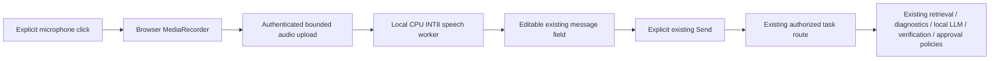

# Current features

## Diagnostic research branch status — 18 October 2026

The previously uncommitted Process 3.3 and Wind 1.2 changes are retained on
`research/diagnostic-guards-review`, separately from `security/v1-remediation`.
References to an accepted configuration below mean the selected local research
baseline, not acceptance for the v1 release or plant deployment. In particular,
the Process sensitivity path produced 57/80 healthy alerts in its recorded fresh
synthetic test; operational reviewer capacity remains unvalidated. The optional
healthy-holdout mode remains disabled by default. No thresholds were retuned in
this review and no diagnostic code was discarded.

Process workflow 3.3's default hybrid detector retains existing DPCA/CVA detections
and adds causal, reference-scaled sustained mean-change alerts across several
sample horizons. Supplemental-only deviations are abnormal **review alerts**, not
confident physical-fault/root diagnoses. Sensitivity improves on fresh synthetic
families, with substantially more healthy alerts; zero missed faults is not promised.
Existing root-analysis masks, authority checks and ControlPlane budget are retained.

Workflow 3.3 remains the final accepted configuration after the weighted-mean and
short-event innovation-energy experiments: no replacement passed the paired
fault-sensitivity gate. Experimental code and complete selection evidence remain
local; fewer false alarms alone did not justify promotion.

Process also includes an **experimental internal** healthy-reference
hold-out calibration mode (`monitoring_calibration='healthy_holdout'`), with
reference-only preprocessing/limits, causal point alarms and short-reference
abstention. It is not the default or a public-form option: broader synthetic
testing reduced false alarms but substantially reduced weak-fault sensitivity.
Existing monitoring defaults and the ControlPlane budget remain unchanged.

Process workflow 3.1 additionally supports optional paired `current_regime_id` /
`reference_regime_id`. A declared mismatch requires review; matching declarations
do not establish authenticity. Sustained simultaneous multi-channel changes can
abstain from a unique-root diagnosis while retaining deviation evidence. Monitoring
thresholds are unchanged; analysis remains retrospective and confidence uncalibrated.

## Versioned diagnostic forms (10 October 2026)

`/integrations` now derives seven task-specific forms from the authoritative
`tsdiag.input_contract` Pydantic models, exposed through the authenticated
`GET /api/integrations/diagnostic-contracts` endpoint. There are no prefilled toy
signals. Switching workflows clears measurements and metadata. Arrays support
JSON import; numeric arrays also support headerless CSV, one sample per row.
Matrices are `[observations, channels]`; vectors require one CSV column.
No implicit column mapping or unit conversion is performed.

Every request requires `contract_version=industrial-diagnostic-v1`, an exact
domain/task/policy combination and collection metadata: asset ID, physical
specimen ID, dataset ID/revision, UTC acquisition start/end, provenance
(`synthetic`, `real`, `public_dataset`) and operating context. An observation-log
document ID is optional, but existing document/sensor linkage checks still apply.

| Workflow | Required measurement/configuration fields |
|---|---|
| Bearing / fault diagnosis | `signal` (>=256 samples), `sampling_rate_hz`, `signal_unit` (`g` or `m/s^2`), `channel_name`, `sensor_location`, `bearing_id`, `shaft_speed_rpm`, `load_percent`, `fault_frequencies` with BPFO/BPFI/BSF/FTF in Hz |
| Process / root cause | `signal_matrix`, `normal_reference`, `channel_names`, `channel_units`, `sampling_rate_hz`, `reference_id`, `reference_revision` |
| Wind SCADA / monitoring | `train_matrix` (>=60 healthy rows), `prediction_matrix`, `channel_names`, `channel_units`, `train_timestamps`, `prediction_timestamps`, `reference_id`, `reference_revision` |
| Battery / cell anomaly localization | `cell_voltage`, `cell_temperature`, `cell_ids`, `timestamps`, `pack_current`, fixed units `V`, `degC`, `A` (positive current = charging) |
| Battery / capacity prognosis | `cycle_index`, `capacity_ah` (>=20 observations), `nominal_capacity_ah`, `eol_capacity_ah`, `capacity_unit=Ah`, `battery_id` |
| Turbofan / RUL | `signal_matrix`, `channel_names`, `channel_units`, `cycle_index`, per-cycle regime IDs `operating_conditions`, `engine_id`, `regime_map_revision`, `require_calibrated_rul=true`; registered `trained_rul_model` reference required |
| Transformer / fault diagnosis | `signal_matrix` (>=32 rows), `sampling_rate_hz`, ordered `sensor_positions`, `channel_units`, `fundamental_hz` |

Other matrices/vectors require at least eight rows. These are computational input
floors, not evidence of sufficient diagnostic accuracy. The generated catalogue
contains exact types, enum values, sizes and optional registered model slots.

The server rejects legacy/unversioned payloads, unknown fields, threshold
overrides, non-finite/coerced values, ragged arrays, misaligned channels/units,
invalid timestamp/cycle order, overlapping Wind reference/prediction periods,
invalid frequencies and inconsistent specimen IDs. Validation runs before
integrated analysis and again at the diagnostic HTTP/tool boundary. Uploaded
workbench JSON must meet the same contract. Authorization and ControlPlane's
2,000-ms gate are unchanged; validation does not prove data authenticity.

Public model selection additionally requires a loaded, checksummed artifact with
matching `metadata.input_profile` (contract version, task, ordered channels,
units, sampling rate). Public Transformer requests no longer silently select a
default classifier. Missing/incompatible models abstain. Bearing currently
exposes its physics workflow, not the separate experimental CNN benchmark.

Last consolidated: 1 October 2026

## Project purpose

SovereignAI is a local-first industrial AI workbench for confidential manufacturing and maintenance work. It is being built to help authorized engineers turn company documents, equipment history, and sensor data into evidence-backed recommendations without sending sensitive data to public AI services.

The project aims to prove that a small local AI system can:

- retrieve only evidence the operator is authorized to see;
- combine documentary and sensor evidence without letting the language model perform safety-critical calculations;
- show citations, uncertainty, conflicts, approvals, and a complete audit trail;
- fail safely when evidence, models, or required services are unavailable; and
- remain advisory—qualified people retain authority over maintenance and physical equipment.

The target outcome is a reproducible Pump-102 industrial pilot in which every released recommendation can be traced from authorized inputs through diagnosis, verification, approval, artifact generation, and a tamper-verifiable Evidence Capsule.

## System boundary

The stable system boundary is:

```text
authenticated operator
  -> authorization and ControlPlane precheck
  -> authorized GraphRAG + sensor diagnostics
  -> bounded evidence context + local Ollama/vLLM generation
  -> ControlPlane release decision
  -> recommendation, scoped artifact, audit, Evidence Capsule
```

SovereignAI owns identity, authorization, orchestration, audit, approvals, and artifacts. Graph-RAG retrieves documentary evidence, the Time-Series Diagnostic Agent produces sensor evidence, and ControlPlane is the final release gate. Required-service failures fail closed.

## Implemented capabilities

| Area | Current capability |
|---|---|
| Local inference | Provider-neutral Ollama/vLLM text generation, Ollama vision, role-aware readiness, streaming, cancellation, timeouts, and FAST/STANDARD/DEEP execution |
| Agent execution | Bounded plan/act/observe/verify flow using registered, schema-validated tools only |
| Evidence | Dense + BM25 retrieval, RRF, optional local reranker, revision/conflict handling, query-aware context compression, provenance, and citations |
| Industrial analysis | OCR and file-type dispatch, deterministic unit/threshold calculations, asset context, read-only telemetry, trends, and Pump-102 inspection workflow |
| Diagnostics | Typed integration with the Time-Series Diagnostic Agent and automatic routing when a valid diagnostic envelope is supplied |
| Governance | PII and prompt-injection checks, structured claim support states, ControlPlane precheck/release control, abstention, and fail-closed handling |
| Security | Local sessions, CSRF, RBAC plus contextual ACLs, authorization before retrieval scoring, scoped caches/resources, and requester/approver separation |
| Execution safety | Generated Python runs only in a restricted, networkless Docker sandbox; there is no host fallback |
| Workflows | Versioned declarative Workcell Packs resolved only to trusted handlers; Pump Inspection v1.0.0 is included |
| Organizations | Validated Organization Packs for hierarchy, users, policies, assets, documents, and organization-scoped Workcells |
| Outputs | Real DOCX, XLSX, and PPTX artifacts with task/evidence lineage |
| Audit and provenance | Persisted task/tool/decision events, SSE progress, SHA-256 Evidence Capsules, independent verification, and optional Ed25519 signing |
| UI | Next.js workbench plus metrics, sovereignty, organization, assets, and onboarding surfaces |

## Flagship workflow

The Pump-102 path combines authorized manuals/SOP/history, sensor diagnosis, deterministic engineering checks, local synthesis, factuality/release control, human approval where required, a maintenance artifact, and an Evidence Capsule. Recommendations remain advisory and cannot command PLC, DCS, SCADA, alarms, setpoints, or equipment.

## Runtime and data

- FastAPI backend and Next.js frontend.
- SQLite for prototype state, audit, metadata, chunks, and caches.
- Local MiniLM embeddings with explicit feature-hashing fallback.
- Configured model roles: GENERAL, VISION, and CODER.
- Loopback/private internal service URLs only; public model/service URLs are rejected.
- APEL synthetic demo: 20 assets, 55 files, seven users, five scenarios, and a 50-question evaluation set.

## Inference experiment tooling

The local-only `local_testing/benchmarks/inference_tradeoff.py --protocol controlled` now runs the version-3
host-local protocol implemented in `local_testing/benchmarks/inference_controls.py`. These harnesses are ignored by Git and must be backed up separately. The old
warm-only protocol is explicitly `legacy-controlled`; `smoke` remains compatible.
Neither legacy mode can mark an experiment complete.

- Provider API identity plus local listener/process identity: Ollama version,
  digest, format, quantization, template/system hashes and selected runtime
  settings; vLLM/PyTorch/Transformers/Python versions, pinned local HF revision,
  weight/config hashes, explicit dtype and selected runtime settings. vLLM must
  use the same Python environment as its harness. Drift fails the experiment.
- Host OS/CPU/RAM and normalized-source harness hash. Per-batch 50 ms host
  available RAM and provider process-tree RSS samples, including errors and
  limitations; unavailable measurements never become zero-valued substitutes.
- Provider-verified **full prompt-token ceilings**, including template overhead.
  The complete fixture is retained; budgets too small for it fail. Neutral padding
  fills remaining space. vLLM uses `/tokenize`; Ollama uses untimed one-token
  calibration. Measured provider usage must agree exactly with calibration.
  `target_tokens` is retained only as a v3 compatibility alias for
  `prompt_token_budget`; historical v2 values remain whitespace words.
- Seeded shuffled repetition blocks cover requested budgets, concurrency 1/2/4,
  warm fresh/reused prefixes, and unprimed cold batches. Each lane has its own
  nonce. Warm-ups are excluded from summaries. Batch throughput uses the actual
  batch wall-clock interval, not a sum across repetitions.
- Reset after calibration and before every batch: Ollama unload acknowledgement
  plus `/api/ps` absence; vLLM requires an external restart, disappearance of the
  previous process tree, a newly created listener, and matching runtime identity.
  The harness never invokes shell commands, terminates processes, or evicts OS
  caches. Failed reset means no cold request. Cold concurrency describes an
  initially cold **batch**, not an independently cold model for each lane.
- Versioned expected-fact/citation JSON schema and fixture provenance/review
  metadata. The shipped fixture is explicitly synthetic and unreviewed. Final
  execution refuses it; `--plan-only` makes no runtime requests. Lexical output
  scoring remains a proxy, even with reviewed expected labels.
- `summary.json` records separate completion gates for both providers, identity
  and its consistency, cold state, warm-ups, memory, complete condition coverage,
  valid token accounting, reviewed real quality labels and failures. Host-local
  partials remain incomplete until a strict matching-config merge. Raw JSON/CSV,
  prompts, answers, samples and source-report hashes are retained. Existing output
  directories cannot be overwritten by a new run.

No final large live benchmark has been run with this protocol. Windows Ollama
and WSL BF16 vLLM constitute a **runtime + format + host** comparison. Process RSS
is not VRAM, may double-count shared pages, and misses between-sample peaks; WSL
reports guest memory. A process restart is not disk/page-cache cold. vLLM loads
weights before serving, so its measured cold request excludes server startup;
Ollama's post-unload request may include loading. Prefix reuse is a controlled
input condition, not proof of a cache hit. The two budget experiment labels both
use full prompt ceilings with fixed evidence; they do not measure retrieval or
evidence-selection quality. See `NEXT_PLAN.md` for commands and remaining gates.

## Important limits

- The project is a prototype, not a production security or safety accreditation.
- GraphRAG needs approved local/self-hosted storage for a strict offline deployment.
- SQLite, in-memory live channels, and local identity are single-node foundations.
- The optional reranker must be staged locally; otherwise retrieval uses RRF fallback.
- OCR, vision, diagnostics, and recommendations require qualified human review.
- Evidence Capsule integrity proves stored-byte integrity, not factual correctness.
- Live enterprise identity, historian, OPC-UA, SAP/Maximo, durable queues, PKI/HSM, malware scanning, encryption/key management, backup/recovery, and signed append-only audit are not yet implemented.
- Plant writes and autonomous maintenance execution are intentionally absent.

See [Past experiments](PAST_EXPERIMENTS.md) for evidence and [Next plan](NEXT_PLAN.md) for priorities.

## Wind measurement safeguard — 11 October 2026

Wind workflow 1.2 adds measurement-quality review for nonfinite values and sustained
flatlines in reference-variable channels. Raw evidence stays available; these
states cannot become a confident equipment-fault decision. Detector thresholds
are unchanged. The guard is conservative and uncalibrated, not full sensor validation.

## Process evaluation update — 11 October 2026

Sensitivity-first workflow 3.3 remains the default. Local trade-off experiments
now compare higher mean-alert thresholds with causal innovation-energy rescue.
They explicitly report missed faults, healthy alerts, paired losses/gains and
per-scenario delays. No candidate has been promoted; experiments stay Git-ignored.
Frozen-threshold distribution/regime stress testing now covers seven conditions
(1,008 records). It exposed a strong-autocorrelation sensitivity gap and frequent
healthy alerts; this is a prototype limitation, not validated generalization.

## ControlPlane verification profiling — 17–18 October 2026

ControlPlane reports sanitized per-run stage timings, NLI pair/forward counts,
batch shapes, model/runtime/device identity, process memory and final action.
Phase 5 no longer repeats unused full-context numeric/date extraction for every
claim. Request-scoped structured evidence tokens and identical claim selections
are reused without crossing source or request boundaries. A distinct relevant
structured passage omitted by the top-k NLI limit prevents an otherwise
supported claim from being released until it is examined. The existing policy
deadline, evidence authority checks and human-review actions remain in force.
Unexamined claims beyond the NLI claim limit, fabricated structured citations,
and support naming only a different asset also abstain. Narrow numeric helpers
cannot clear a semantic coverage hold. No alternative NLI backend or selective
scheduler is enabled; CPU thread/batch defaults are unchanged.

## CPU-only microphone input — 19 October 2026

The workbench microphone is an additional input to the existing task composer.
Click the microphone, grant permission, speak, and click **Stop**. The UI shows
recording time, local processing, errors, and a transcription-ready message.
**Cancel voice** discards the recording or ignores a pending result. The recognized
text is appended to any existing draft. Review asset identifiers and other wording,
edit the message, then click **Run task** (or Enter). Nothing is submitted automatically.
The microphone is never activated on page load. New task and Send are blocked
while recording or processing; navigation/logout releases the microphone.



The transcription endpoint cannot create tasks, retrieve documents, execute tools,
approve actions, or call the LLM. Submitted text uses the existing
`/api/tasks/start` workflow and its current routing and policy decisions; voice
does not change when that workflow chooses GraphRAG, diagnostics, or ControlPlane.
An unsupported or ambiguous question therefore has exactly the same limitations
as its typed equivalent. Diagnostic requests still need validated measurements.

### Runtime choice and installation

The default model is **faster-whisper tiny.en**, loaded with `device="cpu"` and
`compute_type="int8"`. It fits the existing Python/FastAPI backend and avoids a
separate executable build. Its PyAV dependency bundles FFmpeg decoding libraries:
no system FFmpeg, CUDA, GPU, cloud speech API, or additional PyTorch install is
needed for speech. [faster-whisper upstream](https://github.com/SYSTRAN/faster-whisper)
documents CPU INT8 and local model directories. The evaluated alternative,
[whisper.cpp](https://github.com/ggml-org/whisper.cpp), supports quantized CPU models
and Windows, but adds native binary/build and model-format maintenance here.

From the `1_SIH` root, with the existing backend dependencies already installed:

```powershell
.\.venv\Scripts\python.exe -m pip install -r backend\requirements-voice.txt
.\.venv\Scripts\python.exe scripts\download_voice_model.py
Set-Location frontend
npm ci
Set-Location ..
```

The download command is the only online provisioning step. It downloads the
CTranslate2-format `Systran/faster-whisper-tiny.en` model to
`models/faster-whisper-tiny.en`. Copy this complete directory and the installed
packages to an offline machine if needed. Upstream weights are third-party assets;
retain their license when distributing them. Model binaries are Git-ignored.
The application forces offline loading and never downloads a missing model.
Missing packages, missing files, or incompatible model files return
`ASR_MODEL_UNAVAILABLE`. The first valid recording starts a separate worker and
loads the model once; later requests reuse it. Restarting or timing out a worker
causes the next request to initialize again.

Start the backend from the project root so `.env` relative paths resolve there:

```powershell
$env:SOVEREIGN_AUTH_MODE = "local"
.\.venv\Scripts\python.exe -m uvicorn app.main:app --app-dir backend --host 127.0.0.1 --port 8000
```

In a second terminal, from `1_SIH`:

```powershell
Set-Location frontend
$env:NEXT_PUBLIC_API_URL = "http://localhost:8000"
npm run dev
```

Open **http://localhost:3000** and sign in with an existing task-enabled account.
Use `localhost` consistently for UI and API so the existing Strict session and
CSRF cookies share a host. For a new synthetic APEL installation, use the seed
instructions in the repository README first. Keep the existing industrial
services and local LLM running for the same governed answers available to typed
questions. Remote browsers require HTTPS and the existing approved deployment
origin configuration; microphone APIs require a secure context or localhost.

Try “What is the current condition of Pump-102?”, stop, correct the asset spelling
if necessary, and send. Try “Retrieve the maintenance history of Pump-102.” and
“Explain the anomaly detected in Pump-102.” in the same way. Voice does not invent
missing evidence or measurements, or override a held/blocked response.

### Configuration and security boundaries

All settings use the `SOVEREIGN_` prefix and are listed in `.env.example`.

| Setting suffix | Default | Purpose |
| --- | --- | --- |
| `VOICE_MODEL_PATH` | Absolute project `models/faster-whisper-tiny.en` directory | Local CTranslate2 model files |
| `VOICE_LANGUAGE` | `en` | Explicit recognition language; English is the validated initial mode |
| `VOICE_CPU_THREADS` | `2` | CPU inference threads per backend worker |
| `VOICE_MAX_DURATION_SECONDS` | `30` | Hard decoded PCM duration limit; browser auto-stops slightly earlier |
| `VOICE_MAX_UPLOAD_BYTES` | `8388608` | 8 MiB encoded audio limit, including chunked uploads |
| `VOICE_UPLOAD_TIMEOUT_SECONDS` | `15` | Maximum upload wait |
| `VOICE_TIMEOUT_SECONDS` | `90` | Worker response deadline, including decoding and initialization |

For base English, provision `--model base.en` and set `VOICE_MODEL_PATH` to that
complete directory (prefer an absolute path). The language/model seams can support
multilingual models later. VAD, hands-free capture, streaming and spoken responses
are intentionally absent; the recorder and speech service are separate extension
points for those features. No agent logic is duplicated.

`GET /api/voice/config` and `POST /api/voice/transcribe` require the existing
`task.create` permission. POST uses the existing session cookie, credentials and
CSRF mechanism. Sessions and permissions are revalidated after upload and before
returning a transcript. Development auth-disabled behavior remains the same as
typed input; production still forbids disabled auth. Configuration and successful
transcript responses use `Cache-Control: no-store`.

POST accepts a **raw audio body**, not a multipart file. WebM/Opus, Ogg/Opus, MP4
audio, and WAV are allowlisted; declared MIME type and container signatures must
agree. A fixed container decoder reads in-memory bytes and resamples to 16 kHz
mono. Decoded sample counting enforces duration even without metadata. Invalid,
silent, empty, overlong, oversized, and non-audio inputs fail safely. There are no
audio filenames, shell commands, external URLs, multipart disk spools, or temporary
recordings to clean up. Request audio buffers are released; the worker retains
model weights, not a recording history. ASR logs/errors omit audio and transcripts.
After explicit Send, the existing text-task audit and retention rules apply.

One speech job runs per backend process, with no inference queue; overlapping jobs
receive `429 VOICE_BUSY`. Native inference runs outside the API event loop. A hard
response timeout terminates the worker, releases capacity, and returns 504. Cancel
stops the browser microphone/upload and suppresses late results; work already sent
to the server may finish until its deadline. Capacity remains occupied until that
work ends. Use one Uvicorn worker on the target laptop; multiple server workers
would each load a model. Configure normal reverse-proxy connection/body limits for
larger deployments; this prototype does not add a distributed per-user rate limiter.

### Verification and measured performance

Run from `1_SIH`:

```powershell
.\.venv\Scripts\python.exe -m pytest tests\voice -o addopts="" -q
.\.venv\Scripts\python.exe -m pytest local_testing\tests -o addopts="" -q
Set-Location frontend
npm run test:voice
npm run typecheck
npm run build
Set-Location ..
node --test local_testing\frontend_diagnostic_contract.test.cjs
```

The new tests are tracked under `tests/voice` and `frontend/voice-tests`; existing
local regression tests remain in their original ignored locations. Automated tests
use mocked recognition and synthetic PCM, with no model download or real microphone.
Decoder/missing-model subprocess tests skip when optional PyAV is not installed.
Backend tests use an isolated temporary database. Coverage includes authentication,
CSRF, permission denial, expiry/revocation during ASR, upload byte/duration/time
limits, bad formats, unavailable models, repeat requests, hard termination, model
reuse, explicit reviewed submission, existing release/human-review decisions, and
prompt-injection blocking. Recorder tests cover start/stop/cancel, late permission
and response races, disconnects, format support, empty/large recordings, timeout,
auto-stop, and no automatic task submission.

Verified on 19 October 2026: **25 new backend tests passed; 13 recorder tests
passed; 367 existing backend tests passed and 1 skipped; 9 existing frontend
contract tests passed**. Type checking, production build, and `pip check` passed.
Existing suites emitted deprecation/statistical warnings; no failures were observed.

A Windows offline synthetic voice fixture asked two Pump-102 questions in
**7.613 seconds**. Intel Family 6 Model 154, 12 logical CPUs, tiny.en CPU INT8,
2 inference threads, three consecutive local-service runs:

| Run | Model initialization | Transcription | Service voice-to-transcript |
| --- | ---: | ---: | ---: |
| Cold | 0.696 s | 0.718 s | 3.013 s |
| Warm 1 | 0 s | 1.143 s | 1.160 s |
| Warm 2 | 0 s | 1.494 s | 1.523 s |

Peak sampled speech-worker resident memory was **223.8 MiB** at 20 ms intervals;
this excludes the API, browser, LLM and other services and is a sampled peak, not
an allocator high-water mark. Service latency includes spawn/IPC but excludes
microphone capture, permission interaction, and HTTP transport. To reproduce with
a supplied short local recording (the command never prints the transcript):

```powershell
.\.venv\Scripts\python.exe scripts\benchmark_voice.py C:\recordings\question.wav --runs 3
```

A real Chromium MediaRecorder encoded a synthetic microphone stream as WebM/Opus;
the real backend recognized it, populated the editable composer and waited for
explicit Send. Its measured stop/upload-to-response request took **1.570 s**.
The recognized text used “pump 102”; asset spelling remains reviewable. The browser
then submitted through `/api/tasks/start`. Editing the transcript to include an
instruction-bypass attempt and sending it again produced the existing policy block.
Physical microphone hardware/permission
prompts and Safari/Firefox were not exercised. External GraphRAG, ControlPlane,
and diagnostics services were unavailable locally; full live multi-service release
was not verified. Their authorization/release integration was verified with mocks
and the existing security regressions. Tiny-model recognition quality, noisy rooms,
industrial abbreviations, and accent coverage need representative human audio
evaluation before broader deployment.

Implementation files: `backend/app/api/voice.py`, `backend/app/multimodal/speech.py`,
`backend/app/main.py`, `backend/app/core/config.py`, `backend/requirements-voice.txt`,
`frontend/app/voice/{VoiceInput.tsx,recorder.ts}`, the existing composer/CSS,
`frontend/voice-tests/recorder.test.cjs`, `frontend/package.json`,
`tests/voice/test_speech.py`, `scripts/{download_voice_model,benchmark_voice}.py`,
`.env.example`, `.gitignore`, and `pyproject.toml`.

## Simple tools and visible agent workflows — 20 October 2026

The workbench now offers **Calculator**, **Unit conversion**, and **Three-step
workflow** examples below the empty conversation. Choosing one fills the editable
composer and selects Controlled Agent mode; press **Run task** to execute it.
Examples also select the **Arithmetic tools only** catalogue to keep CPU model
selection focused. **Use all tools** restores the usual catalogue. This is the
existing bounded agent with a smaller registry, not a separate execution path.
The API's `tool_scope` defaults to `ALL`; `NUMERIC` restricts the available tools
to the three read-only numerical tools and requires Automatic/Controlled mode
without attachments or a Workcell. Numeric scope cannot launch specialist-service
or file/code workflows. A normal typed request keeps the full catalogue.
The examples require `tool.execute` permission, a running configured local LLM,
and no attachments or selected Workcell. They work with the same reviewed text
submission used by microphone input. No GraphRAG server, diagnostic data, Docker,
new package, or cloud service is needed for these numerical examples.

| Tool | Example input | Expected observation |
| --- | --- | --- |
| `calculate` | `(125 * 8) + 50` | `1050` |
| `summarize_numbers` | `[10, 20, 30]` | count `3`, total `60`, mean/median `20`, minimum `10`, maximum `30` |
| `convert_units` | `250 kPa` to `bar` | `2.5 bar` |

The three-step example asks the model to summarize `[10, 20, 30]`, multiply the
**observed mean** by eight, and convert that result from kPa to bar. Check the
actual calls for **20 → 160 → 1.6 bar**. Expected results on the example buttons
are reference answers, not evidence that anything ran. The local model still
selects every call using the existing bounded agent; no canned tool responses or
separate demo agent were added.

An **Agent workflow** panel appears in the conversation as tools execute, including
on narrow/mobile layouts. It shows the proposed tool, permission/policy gate,
actual start, observed output or failure, input arguments, execution time, and
numeric validation. Final tool records remain inspectable after the answer arrives.
The existing agent-execution sidebar still shows the plan and the final safety
decision. Tool events are now published during execution and are not replayed
after completion. A failed/denied call never receives a successful label, and a
held call displays its approval requirement without executing.

The completion check requires successful observations for simple tools explicitly
named in the request; the model cannot simply claim they ran. Incomplete named-tool
workflows fail visibly, retaining partial observations. This verifies that requested
tool steps ran; it does **not** independently verify the model's interpretation of
the request or final prose. Existing grounding, authorization, audit and approval
checks still apply to the final task. Evidence from these tools is clearly labeled
as a local computation using user-supplied numbers, never a real plant measurement.

Arithmetic uses an AST interpreter with numeric literals and a small operator
allowlist, never `eval`, shell access, Python sandbox execution, or function calls.
Expressions are limited to 200 characters/64 AST nodes, finite intermediate values
of magnitude at most `1e15`, and exponent magnitude at most 12. Number summaries
accept 1–256 finite numeric values, each at most `1e12` in magnitude. Unit conversion
reuses the existing Pint-backed `UnitService` with its supported unit aliases and
dimension checks, returning up to eight decimal places. All three tools are local,
read-only, schema-validated and enabled as LOW-risk tools in `config/tools.yaml`.
Their normal permission and policy gates remain active even for these examples.

To try it, start the backend and frontend with the launch commands above, sign in
as a task/tool-enabled user (e.g. an engineer), choose **Three-step workflow**, and
send. To type it directly:

```text
Use summarize_numbers on [10, 20, 30]. Then use calculate to multiply the observed
mean by 8. Then use convert_units to convert that calculated value from kPa to bar.
Report the actual results from all three tools. These are example numbers, not
plant measurements.
```

CPU model selection/synthesis can take much longer than the arithmetic itself;
the agent retains its existing limits of six tool calls, eight decisions and
180 seconds. An unavailable model or execution bound is reported rather than
replaced with a scripted successful demonstration. The trace makes actual
intermediate results available even if final model synthesis cannot finish.

Verification commands from `1_SIH`:

```powershell
.\.venv\Scripts\python.exe -m pytest tests\agent_tools -o addopts="" -q
.\.venv\Scripts\python.exe -m pytest local_testing\tests tests\voice -o addopts="" -q
Set-Location frontend
npm run test:agent-tools
npm run test:voice
npm run typecheck
npm run build
```

Validated: **51 new backend tests**, **7 new UI tests**, **392 existing backend/voice
tests passed with 1 skipped**, **13 recorder tests**, and **9 existing frontend
contract tests passed**. Production compilation and type checking passed. Tests
exercise real numerical tools in the existing agent with scripted model decisions,
chained observations, authorization denial, approval holds, refusal of fabricated
completion, failed/partial workflows, grounding evidence, and actual task/SSE routing
without duplicate execution events. No model or microphone download is needed for
these automated tests.

Live validation used the installed local `qwen3:4b-instruct` model on CPU and
Chromium's production UI: the model selected all three tools, consumed mean `20`
in `calculate`, supplied result `160` to `convert_units`, received `1.6 bar`, and
returned the correct final summary. The warm CPU browser run took **89.8 seconds**
from task acceptance to completion. The existing final grounding check reported
**REWRITE (72% grounding)** for the answer wording; it was not suppressed or
treated as an approved release. Initial live attempts exposed omitted tool names;
the numeric decision schema now requires a tool name and schema-valid arguments
for a tool action, and the trace exposes rejected decisions. A completion action
has its own required final-response schema. No test was weakened to obtain success.

Files: `backend/app/tools/simple_tools.py`, existing tool registry/policy,
`backend/app/agent/tool_agent.py`, task routing and chat-mode selection,
`frontend/app/agent-tools/{AgentExamples,AgentTrace}.tsx`, composer/CSS,
`tests/agent_tools/test_simple_tools.py`, frontend component tests and package script,
`.gitignore`, `pyproject.toml`, and this maintained feature document.

## Workflow optimization, stage 1: retained latency measurements — 20 October 2026

Every task created through the synchronous task API or `/api/tasks/start` now
retains a `runtime_metrics.timing` report. The conversation displays it in
**Where the time went** after completion. Old runs without timing remain readable.
This stage adds measurement; workflow selection and inference budgets are not yet
optimized. Subsequent stages are the shared execution selector, validated general
plans, adaptive-agent improvements, and comparative industrial-task evaluation.

The request-local collector records each Ollama/vLLM text-provider call, including
structured decisions, streamed answers, coding/repair calls and integration answer
generation when those calls run inside the task handler. It retains the actual
provider/model, purpose, outcome, warm/cold state, wall time, queue wait, prompt and
output tokens, and available provider timings. It stores no prompts, generated
text, tool arguments or error text in the timing report. Context isolation keeps
concurrent requests separate. A streamed `generate()` counts once; cancellation
continues to close the underlying stream and propagate to the existing task code.

Ollama now exposes `prompt_eval_duration` and `eval_duration` as prompt-processing
and generation seconds. Missing token counts and measurements remain null. vLLM
usage supplies token counts where available; separate prefill/decode/load timings
remain unavailable when its response does not expose them. Structured responses
have no measured time to first token. The UI distinguishes unavailable fields from
measured zero and never treats them as zero-cost work.

The report separately times input checks, execution, final grounding/governance,
and initial persistence plus audit writes. Per-call model and bounded-agent tool
durations are nested inside execution; they must not be added to stage totals.
Concurrent call sums are not critical-path wall time. The task-handler total
excludes initial background admission events, the final timing-snapshot write,
subsequent SSE delivery and browser rendering. Vision, external-service internals
and individual Workcell tools are not separately instrumented in this stage; their
cost is included in execution. Existing integration service timings also remain
available in their original metrics.

Completed reports are saved with the task, survive GET/reopening, and arrive in
the existing final SSE result. Failed/cancelled handlers attempt a `task_timing`
event with an explicitly partial report before the original error propagates.
If event persistence itself is broken, reporting does not replace the original
failure. Existing task authorization and release checks govern these records.

### Validation and observed baseline

- 15 new backend timing tests cover both real provider adapters with mocked HTTP,
  streaming without double counting, missing measurements, failure/fallback,
  cancellation, stream cleanup, concurrent isolation, partial error reports, and
  actual tool execution through API/SSE with persisted metrics. Mock durations are
  contract fixtures, not performance evidence.
- Four new UI tests cover stage/call rendering, unavailable versus zero, old runs,
  escaping and partial reports (11 agent-tools UI tests total).
- The backend regression suite passed with one existing skip. The final timing/SSE
  targeted run passed 16 tests. Frontend typecheck and production build passed.

A single real-model probe used an isolated SQLite DB and the existing three-tool
example with `qwen3:4b-instruct` on CPU (`size_vram: 0`). A process-only provider
override selected Ollama for this probe; no `.env` changes were made. This was a
cold-start observation, not a controlled comparison with the earlier warm browser
run or evidence of a speed improvement:

| Measurement | Observed seconds |
|---|---:|
| Task handler | 116.087 |
| Four model-call wall times combined | 109.760 |
| Prompt processing across calls | 50.300 |
| Token generation across calls | 48.122 |
| Model loading across calls | 9.907 |
| Queue wait | 0.000 |
| Three tools combined | 0.243 |
| Final grounding/governance | 5.924 |
| Persistence/audit | 0.142 |

The model generated 348 tokens across four calls, at 6.720–7.977 tokens/second
per call. All three tools succeeded; final governance remained `REWRITE`.
The configured-provider probe separately found that the current provider override
selected an unavailable vLLM `Qwen/Qwen3-0.6B` endpoint even though model routing
reported Qwen3 4B. The timing report exposes the actual model/provider for each
call, so routing metadata is not confused with runtime identity. Select a running
provider deliberately with `SOVEREIGN_LLM_PROVIDER`; model routing alone does not
override the configured vLLM backend.

Files: `backend/app/monitoring/timing.py`, Ollama/vLLM adapters, bounded tool agent,
task handler, `frontend/app/agent-tools/RuntimeTiming.tsx`, composer/CSS,
`tests/agent_tools/test_timing.py` and frontend component tests. Ignored local probe
evidence is retained under `local_testing/agent_tools/timing-live-ollama.json`.

## Shared workflow selection (stage 2)

Tasks now pass through `WorkflowSelector` before execution. It consolidates the
existing integration, Workcell, coding, retrieval and tool-agent dispatch rules
into one deterministic selector. Selecting a workflow does not call an LLM.
Execution mode (`FAST`/`STANDARD`/`DEEP`) remains a separate inference budget.

| Strategy | Current execution | Example |
|---|---|---|
| `DIRECT` | Existing response generator | Explain pump cavitation |
| `RETRIEVAL` | Authorized asset/context retrieval or Graph-RAG plus Controlplane | Assess Pump-102; answer according to the SOP |
| `WORKFLOW` | Existing Workcell, bounded CSV coding workflow, or diagnostic service plus Controlplane | Run an inspection Workcell; diagnose bearing vibration |
| `ADAPTIVE` | Existing bounded registered-tool agent | Calculate; read a file; analyze an image; create a report |
| `BLOCKED` | Input-policy block before service planning, tools or inference | Prompt-injection request |

The selector respects explicit chat modes, Workcells and the restricted numeric
catalogue. Automatic mode also recognizes existing file/image/OCR tool signals
that previously could fall through to General Chat. Explicit General Chat still
does not open attachments. Tool and Workcell permissions, workspace boundaries,
validated diagnostic inputs, approval rules and final release checks remain in
their existing executors. A selected route does not grant access or imply success.
An unavailable integration stays unreleased; it does not silently become an
unsupported direct answer.

Integration planning happens once, and execution reuses that validated plan.
Public selection metadata contains the strategy, handler, rule, explanation,
domain, capabilities, selected services, missing-input status and selection
duration. Raw diagnostic measurements are not copied into that metadata.
`workflow_selected` is emitted before execution; the result's typed
`workflow_selection` is saved with the task and recorded as a `workflow_selection`
audit event. The UI displays the decision live and from completed results.
Old saved tasks without this optional field remain readable.

At the end of stage 2, `PLANNED` was reserved for stage 3. Predictable chains across numerical, file,
image or reporting tools are marked as planning candidates but still execute
through `ADAPTIVE`. The UI explicitly explains this fallback. Candidate detection
is descriptive and does not bypass validation or execute an unimplemented plan.
Stage 3 below replaces that candidate fallback with a validated plan executor.
These rules provide a shared starting point rather than a universal natural
language classifier; new workflow families need explicit routing cases and tests.

### Provider and validation

During stage 2, Ollama's configured local endpoint responded and listed
`qwen3:4b-instruct`; the configured vLLM models endpoint was unreachable. The
ignored project-root `.env` now selects `SOVEREIGN_LLM_PROVIDER=ollama`, as
authorized. No model tags, inference budgets or other environment values were
changed. Existing backend processes need a restart to reload saved configuration.
No vLLM-versus-Ollama latency comparison is claimed because vLLM was unavailable.

- 44 selector tests cover industrial routing, explicit modes, scope constraints,
  missing and validated diagnostic input, workspace escape rejection, actual
  dispatch, persisted decisions/audit, policy blocks and permission denial.
- API/SSE verification retains four inference calls for the actual three-tool
  example, emits selection before tool execution, and restores the same selection
  through GET. Selection adds no model round trip.
- Three new UI tests cover readable choices, old tasks, planning fallback,
  missing inputs and escaped metadata (14 agent-tools UI tests total).
- Full configured backend regression: 502 passed, one existing skip. All 14
  agent-tools component tests and the frontend production build/typecheck passed.
- A real configured-provider request, using an isolated SQLite database and no
  provider override, selected `DIRECT` and completed through Ollama
  `qwen3:4b-instruct` with one model call. Selection took 0.001128 seconds and the
  task handler took 8.692 seconds. This single explanatory request is smoke-test
  evidence, not a comparison with the multi-tool latency baseline.

Core files: `backend/app/orchestration/workflow_selector.py`, task dispatch,
`AgentRunState`, `frontend/app/agent-tools/WorkflowSelection.tsx`, composer,
`tests/agent_tools/test_workflow_selector.py` and API/SSE/component tests.
Ignored live evidence: `local_testing/agent_tools/workflow-live-ollama.json`.

## General structured-plan execution (stage 3)

Predictable tool chains now select `PLANNED` / `structured_plan`. The local model
proposes a bounded plan once. The application validates the complete dependency
graph and tool inputs, executes registered tools in dependency order, and makes
one final answer-generation call from actual observations. Investigations continue
to use the existing adaptive agent. Workflow selection itself still calls no LLM.

The executor works with the selected registered catalogue, including file access,
authorized knowledge retrieval, OCR/vision, numerical tools and artifact creation.
For example, it can read a file and pass the observed text into a Word report;
the numerical scope can pass an observed mean into arithmetic and the calculated
result into a unit conversion. The generic binding mechanism is not restricted to
mathematics. Existing established Workcells and integration workflows retain their
precedence rather than becoming arbitrary model-generated tool plans.

### Plan protocol and execution boundaries

- A plan contains at most six registered-tool steps with unique IDs, argument
  objects and explicit dependencies. Execution is sequential in topological order;
  independent steps are not run concurrently against shared DB/session resources.
- `{"$ref":"stats.mean"}` supplies a typed value from the actual `stats` output.
  Array indices use dotted paths, such as `evidence.results.0.text`.
  `{"$concat":[{"$ref":"stats.mean"}," * 8"]}` creates a string argument from
  observed scalar values. Text also supports `{{stats.mean}} * 8`; an inline
  reference object such as `{"$ref":"stats.mean"} * 8` is accepted as the same
  scalar text binding. These references must declare dependencies and are replaced
  once with actual outputs. Bindings traverse JSON data only; no eval, code execution,
  arbitrary object attributes, shell access, loops or conditional expressions are
  added to the protocol. Retrieved data is never recursively treated as a binding.
- Static validation checks tools, IDs, cycles, declared references, required and
  unknown arguments, literal field types, array/string/numeric bounds, finite
  numbers, explicitly requested tools, nesting and plan size. Deferred output
  values are resolved and type/size checked again before their consumer executes.
  Unsupported tool-schema features fail closed. Schema validation covers the
  catalogue's inline subset; tool-specific semantic validation remains in each tool.
- Generation uses a schema tied to each tool's input contract, with explicit
  binding alternatives. Word report sections now describe their actual
  `heading`/`content` fields. A first live probe exposed an inline pseudo-reference
  inside a calculator string; the calculator refused it and dependents did not run.
  Schema constraints alone did not make this CPU model follow the original
  `$concat` format reliably. The final implementation accepts explicit, validated
  text templates and inline reference objects as well as typed `$ref` objects.
- Authorization and disabled-policy preflight apply to the whole remainder.
  Every invocation also reuses the adaptive agent's shared permission, ActionGuard,
  approval, tool-timeout, timing and trace boundary. Artifact run identity is always
  assigned by the application. Approval requests retain the exact resolved args and
  existing action hash. A pause does not execute its remaining plan steps; the
  existing approval flow handles the proposed action, without automatic plan resume.
- An initial rejected/deferred plan may fall back to the adaptive agent before any
  tool runs. Saved workflow metadata reports the actual adaptive fallback. The
  planning attempt adds a model call on this exceptional path.
- An unavailable/wrongly typed output binding permits one model revision of the
  unexecuted remainder, using retained successful outputs. Completed IDs cannot be
  replaced and exact successful calls cannot be replayed. Six total tool calls,
  one revision and a 180-second total bound include fallback and synthesis.
- A failed, denied or timed-out tool stops execution; dependents do not run and
  unknown side effects are not automatically retried. Partial results are retained
  and never marked complete. Cancellation stops the active plan task. If all steps
  succeed but answer synthesis is unavailable, actual observations are returned.
  Existing final grounding/governance checks still apply to every response.

The task stores optional `structured_plan` metadata: plan history, dependencies,
step statuses, revision count and completion/fallback/approval status. It survives
GET and is recorded as a `structured_plan` audit event. SSE emits `plan_validated`,
`plan_revision_requested`, `plan_stopped` and `workflow_fallback`, alongside actual
tool events. The UI shows plan arguments/references and step statuses, with old
tasks remaining readable. Live validated steps remain pending until actual results
arrive; validation alone never implies successful execution.

### Validation

30 structured-plan tests cover real three-tool execution with two timed inference
calls; an actual file-to-Word artifact; malformed plans, types, cycles and scope;
bounded remainder revisions without replay; tool failures and partial completion;
permission/disabled-policy preflight; exact persisted approval args and withheld
dependents; cancellation/time bounds; adaptive fallback metadata; and API/SSE,
saved results and audit records. Existing adaptive tests retain their four-call
coverage using investigation requests. All 16 agent-tools UI tests and the
frontend production build/typecheck pass.

Final backend regression after the stage 3 changes: **537 passed, one existing
skip**. The existing dependency/statistical warnings remain unchanged.

A real smoke test used the saved Ollama provider with `qwen3:4b-instruct`, the
existing three-tool example, and an isolated task database. All three steps
completed with the observed mean (20) passed into arithmetic (160) and then into
unit conversion (1.6 bar). The model generated a text template for arithmetic and
a typed output reference for conversion. It needed two model calls, no revision,
and no adaptive fallback. Observed timings were:

| Measurement | Seconds |
|---|---:|
| Task handler | 133.360 |
| Plan-generation call | 63.298 |
| Answer-generation call | 57.924 |
| Three tools combined | 0.706 |
| Final grounding/governance | 11.263 |

This demonstrates the reduction from four calls to two for this workflow, not an
end-to-end speed improvement. The model generated 338 tokens across both calls at
4.45-4.94 tokens/second, with 46.637 seconds of combined prompt processing. CPU
load/throughput and inference remain material costs; earlier observations used
different load and warm-start conditions and are not a controlled comparison.
Final governance remained `REWRITE`, as in the earlier numeric example; successful
tool execution does not bypass that existing grounding decision. No provider,
model tag or inference budget was changed during stage 3. Ignored evidence is
retained at `local_testing/agent_tools/structured-plan-live-ollama.json`.

Files: `backend/app/orchestration/structured_plan.py`,
`backend/app/agent/planned_agent.py`, shared bounded-agent invocation, selector,
task dispatch/state/audit, report tool input contract,
`frontend/app/agent-tools/StructuredPlan.tsx`, and structured-plan tests.

## Prompt compaction and verified-result formatting

The next latency pass keeps Ollama and the existing `qwen3:4b-instruct` default.
The installed model is already `Q4_K_M`; no further weight quantization or saved
model/provider/inference-budget changes were made.

Planning now uses compact tool descriptions and argument/output shapes instead
of repeating the full schemas in ordinary prompts. Authoritative generation and
execution schemas still enforce the original constraints. Explicitly named tools
can form a smaller planning catalogue; unnamed requests or attachments retain the
catalogue, and an insufficient shortlist can defer to the existing adaptive agent.
Artifact requests retain fuller contracts for nested report inputs. Prompt metrics
record character counts, catalogue sizes/style and prompt/schema fingerprints for
future comparisons, without storing another copy of the raw prompt.

Answer/decision context removes redundant numerical validation prose and duplicate
computation evidence. Numerical source identifiers and citation metadata remain
available, and retrieval evidence keeps its text and citations. Original results,
sources and audit records are retained unchanged.

Completed factual plans can now return application-formatted results directly:
arithmetic, numerical summaries, conversions, file lists/metadata, and registered
artifact receipts. A read-to-artifact workflow can acknowledge the actual file
read and artifact created without inventing an interpretation of the document.
Unsupported results and requests for explanation, diagnosis, comparison, citations
or recommendations retain model synthesis. Failed, denied, incomplete and
approval-paused plans cannot use the formatter. Existing final grounding and
governance checks still run; this is not a release-policy bypass.

`runtime_metrics.response_generation` identifies `verified_formatter`, `llm`, or
the existing observation fallback. The timing panel explains when no final
answer-generation call was needed. This does not imply that the planning model
call disappeared.

### Findings and corrections

Initial over-compaction caused malformed references and unnecessary adaptive
fallbacks. Binding examples and the distinction between unknown data and a new
decision were restored. More compression was not assumed to be better.

The file/report smoke test also exposed an underspecified citation input contract:
the model supplied strings where Word generation expected citation objects. The
schema now checks citation objects before invocation, while allowing existing
source metadata and nullable page/section values.

An adaptive fallback then claimed a report existed after only reading its input.
Completion validation previously checked explicitly requested numerical tools
only. It now checks every explicitly named registered tool, so an unexecuted
`generate_docx` cannot satisfy completion. A regression test verifies that the
false artifact claim is rejected. These checks do not guarantee that the local
model can successfully plan every reporting request.

### Live observations and model comparison

`scripts/benchmark_workflow_latency.py` runs isolated tasks using installed models,
temporary workspaces/databases, real registered tools, dependency checks and actual
Word-file inspection. It does not download models or change production defaults.
Model preloading is excluded from task timings; benchmark model caches are released
after each group. `--append` retains completed samples; `--retry-failed` preserves
earlier attempts; failed quality checks stop further sampling unless `--keep-going`
is requested. Samples collected during tuning are observations, not a controlled
statistical comparison; schema/prompt corrections and prior attempts must be
considered when interpreting them.

| Sample | Model | Model calls | Handler seconds | Quality result |
|---|---|---:|---:|---|
| Earlier three-tool baseline | Qwen3 4B | 2 | 133.360 | All tools completed; final governance `REWRITE` |
| Three-tool chain with factual formatting | Qwen3 4B | 1 | 81.678 | Actual mean, scaling and conversion correct |
| Conversion followed by arithmetic | Qwen3 4B | 1 | 56.674 | Correct result and observed-value binding |
| Three-tool chain | Installed `qwen3:0.6b` | 3 | 180.241 | Failed; execution bound reached |
| Conversion followed by arithmetic | Installed `qwen3:0.6b` | 9 | 60.235 | Failed workflow check |
| File-to-report request | Installed `qwen3:0.6b` | 2 | 18.768 | Failed workflow check |

The smaller model produced tokens faster in its first sample, but invalid plans
and retries prevented a valid workflow. It was not promoted to the default. The
4B live file/report sample also did not pass the strict workflow/artifact check
during tuning; complex report planning remains a model-quality limitation. Fuller
report contracts and explicit copy guidance are retained, and missing artifact
execution is rejected rather than accepted as completion. Unit/integration tests
separately verify that a valid file-to-report plan creates an actual Word artifact.

In the successful three-tool sample, planning prompt tokens fell from the earlier
813 to 434; the former 647-token answer prompt was eliminated. Generated tokens
fell from 338 across two calls to 198 in one. Model-call time was 71.846 seconds.
This is an observed reduction for that request, not a guaranteed speedup across
industrial tasks. CPU use around 95% and RAM use around 94% were observed during
sampling; the 4B model used CPU (`size_vram: 0`). Resource pressure and grounding
cost still matter, and the successful numeric responses remained `REWRITE` under
the existing grounding policy. No claim is made that grounding has been fixed.

Validation: **553 backend tests passed, one existing skip**; **17 agent-tools UI
tests passed**; frontend production build/typecheck passed. New tests cover the
one-call API/SSE path with grounding still invoked, interpretation/citation opt-outs,
actual receipts, preserved evidence, scoped catalogues, citation contracts and
prevention of unexecuted artifact claims. Ignored live evidence is retained in
`local_testing/agent_tools/latency-comparison.json`, with earlier attempts preserved.

## Agentic task continuity: step 1 — task states and completion criteria

The first stage of the task-continuity roadmap adds a shared deterministic
lifecycle assessment. A returned task now distinguishes `completed`, `failed`,
`blocked`, `waiting_for_input`, and `waiting_for_approval`; the state contract also
supports `planning`, `running`, and `cancelled` for the following persistence stage.

`AgentRunState.lifecycle` records the active plan's step identifiers, completed and
remaining steps, the current or stopping step, approval references, required input,
waiting/failure reason, execution completion checks, and response-release status.
Structured-plan identifiers take precedence while that plan is active; an adaptive
fallback uses its actual agent steps. This metadata uses existing saved task JSON
and needs no database schema migration. Older runs derive the same assessment on
read without rewriting their stored records or timestamps. Task-list status agrees
with task-detail status.

Completion requires completed recorded steps, successful recorded tool calls, a
non-empty response, supplied required input, and no pending approval. Execution
completion remains separate from answer release: an executed numerical workflow
can still require `REWRITE` under the existing grounding policy. Lifecycle checks
do not override release controls, and a failed task is not promoted to approval
merely because its failure response triggers grounding review.

Previously, an unavailable industrial service and a missing diagnostic payload
could appear as completed tasks. Service failure now stays failed; policy blocks
stay blocked; genuine human-review holds stay waiting for approval. A diagnostic
request without validated measured input pauses with an attachment requirement,
without invoking the local model or specialist services. Existing input policy
checks still run first. Local-provider fallback text also no longer counts as a
successfully generated model answer.

The execution stream ends with `task_completed`, `task_paused`, `task_failed`,
`task_cancelled`, or `task_blocked` according to the actual returned outcome. The
Workbench consumes each outcome and displays progress, waiting/failure reasons,
approval references, completion checks, and the separate release decision. New
clients must handle the paused and blocked events instead of assuming every
returned run emits `task_completed`.

Step 1 supplied outcome metadata for returned runs. The following step 2 adds
durable snapshots, including cancellation and exceptions before a handler returns.
Resumption after approval is supplied by step 3 below. Clarification replies are supplied by step 4 below.

Validation: the full backend regression run passed **581 tests with one existing
skip**. After the final completion-check refinement, **31 lifecycle tests passed**,
including three additional save/read idempotency cases. All **19 agent-tools UI
tests** and the frontend production build/typecheck passed. Tests cover zero-model
missing-input pauses, persisted/audited status, blocked and failed stream outcomes,
approval references, actual plan progress, legacy saved runs, release-policy
separation, provider fallback failure, and escaped interface output.

The implementation order after step 1 is:

1. Durable per-step execution checkpoints and interrupted-task detection — completed in step 2 below.
2. Safe resume, permission revalidation, and duplicate-action prevention - completed for the supported handlers in step 3 below.
3. Same-task clarification and missing-input replies - implemented in step 4 below.
4. Operator cancellation/resume controls connected to persisted task state.
5. One validated industrial diagnostic/report procedure.
6. Bounded, typed failure recovery.
7. Workspace-scoped memory with provenance and expiry.
8. Scheduled/event-triggered read-only procedures.
9. End-to-end industrial outcome and latency evaluations.

## Agentic task continuity: step 2 — durable execution checkpoints

Accepted requests and their access scope are committed before a background worker
is scheduled. New asynchronous tasks use the same identifier for tracking, stored
run state, tool operations, artifacts and approvals. Older tracking IDs can still
resolve their linked run. Original validated request settings, attachment paths,
execution limits and selected tool-agent runtime are retained for the later resume
stage; login cookies and credentials are not copied into checkpoint metadata.

Two additive tables retain the execution owner/request/lease and append checkpoint
history. Existing `agent_runs` rows expose the latest snapshot. Each checkpoint has
a monotonic revision, named boundary, timestamp and SHA-256 of its saved state JSON.
The checksum identifies stored content; it is not an authenticated signature.
`init_db` creates the tables on application startup; existing task rows remain
readable without a backfill.

Checkpoints cover:

- Direct-response agent plans and step boundaries.
- Structured-plan proposals, validation, revisions and actual tool steps.
- Adaptive decision boundaries and registered-tool execution.
- Exact resolved tool arguments, action hashes, operation IDs, full returned
  outputs, observed artifacts and source evidence, before publishing completion.
- Workcell step inputs/results and completed-step metadata, sandbox attempt code
  and outcomes, and industrial prechecks, individual evidence-service results,
  generated candidates and release checks. Independent service results persist
  even while another evidence service is still pending.
- Final governance/audit boundaries, paused tasks, cancellation and unhandled
  failures. A response that finished generating stays an active draft until the
  final execution outcome has been saved.

The last checkpoint survives a hard process exit. If execution stops between a
tool's invocation and its result checkpoint, the operation becomes `unknown` and
`requires_reconciliation` is set. A file may already exist even though the host
never recorded a successful tool result. Recovery preserves that uncertainty and
does not claim either successful completion or guaranteed absence of side effects.
Already saved successful outputs and pending steps remain intact.

Workers claim execution atomically. A heartbeat renews a 60-second lease every
10 seconds while model calls or tools are awaited. Startup and authorized task
reads detect expired leases, record an `interrupted` outcome, and fence the old
worker from further state writes or actions. An unexpired lease is not treated as
abandoned merely because a request reaches another process. Detection can take
up to the lease period after the last renewal and occurs when recovery is checked.
Heartbeat and checkpoint writes add local database work and do not add LLM calls.

Task-detail/list reads and the new `GET /api/tasks/{id}/checkpoints` endpoint retain
the existing task authorization checks. Checkpoint history returns the latest
100 revision descriptors. If the in-memory event channel is unavailable,
`GET /api/tasks/{id}/events` reconstructs a read-only stream from saved events and
the current snapshot. It emits `task_interrupted` for an expired worker or
`task_snapshot` when a lease is still valid; reconnecting never schedules a worker.
The stream continues to check session validity. Existing cancellation can finalize
an unstarted/paused task, signal an active local worker, or record a cancellation
request for another worker to observe.

The Workbench displays checkpoint revision/boundary, interruption reasons and
uncertain tool outcomes. Its Saved Tasks selector and Refresh Saved Progress
button load stored progress using read-only API calls, including after an
application/browser restart. They do not resume a task or execute a tool. Refresh
the saved state after lease expiry to observe an interrupted worker's new status.

Automatic/approved continuation, receipt reconciliation, changed-input handling,
fresh tool authorization before resume, and duplicate-side-effect prevention
are supplied by **step 3 below** for supported task handlers. Step 2 deliberately supplies durable state and recovery reads;
it does not replay interrupted workflows. Trusted composite handlers retain their
available step/attempt results; the implementation does not promise recovery at
every internal instruction or exactly-once execution of an external side effect.
Ollama, the model tag, quantization and inference budgets are unchanged.

Validation: **597 backend tests passed with one existing skip**. Following the
final paused/cancelled stream replay correction, **15 checkpoint/stream tests
passed**. All **21 agent-tools UI tests** and the frontend production build with
typecheck passed. Verification includes a real subprocess exit after actual Word
artifact creation but before the host tool result was committed: the earlier
calculation survived, the report operation recovered as unknown, and reopening
the task neither recreated nor changed the file. Other checks cover committed
results before live events, between-step and in-tool cancellation, exception
preservation, partial parallel-service results, checkpoint-write failure before
execution, lease renewal, duplicate worker claims, stale-worker fencing, scoped
history reads, and event recovery with/without the original in-memory channel.


## Agentic task continuity: step 3 - safe resume and receipt reconciliation

The Workbench now offers **Resume saved task** for the task owner when saved
progress is interrupted, cancelled, failed or waiting for approval. Opening and
refreshing saved progress remain read-only. Resume is an explicit
`POST /api/tasks/{id}/resume` with `{"checkpoint_revision": <latest revision>}`;
it returns HTTP 202 with the original task ID and starts a new live event stream.
The request accepts no replacement prompt, arguments, attachments or tool scope.
Refresh first if another worker or approval changed the checkpoint.

Before claiming execution, resume reloads the current local identity, checks that
the requester still owns the task, verifies task access in its original
organization/workspace, and rechecks current tool, evidence and artifact access.
Disabled identities/tools, missing permissions, changed file inputs/outputs,
changed actions, mismatched approval scope, stale revisions and inconsistent
checkpoint/receipt checksums stop continuation. Current identity and policy are
checked again before resumed model decisions and actions. Artifact ownership
keeps the original task workspace even if workspace membership ordering changes.
Resume denial is audited and preserves the saved progress.

A new additive `tool_execution_receipts` table binds each successful tool result to its
operation ID, task ID, exact tool/arguments hash, result checksum and available
file fingerprints. Artifact registration and its receipt commit in the same
SQLite transaction for Word, Excel and PowerPoint tools. Approved text writes
record a receipt after the write. Filesystem changes and database commits are
not one atomic operation: a crash between a write and its receipt remains unknown
and is blocked rather than retried. A matching receipt can recover a completed
artifact/write whose host result checkpoint was lost. Changed or missing output
files cannot be treated as confirmed successful results.

The supported continuation paths are:

- **Structured plans:** revalidate the saved DAG, restore completed outputs and
  their exact dependency bindings, then execute only uncompleted steps. Resume
  does not call the planner again when a validated saved plan exists.
- **Adaptive tool tasks:** retain actual observations, completed-call signatures,
  previous steps and decision counts. Identical successful calls cannot run again.
- **Direct answers:** keep a fully generated answer and skip its completed
  generation step. Interrupted generation without a completed answer may restart
  within the remaining time budget; partial tokens are not a confirmed answer.
- **Accepted but unstarted tasks:** safely select and execute the original request
  after worker-loss recovery when no operation has run.

A completed draft can resume its final local governance/audit boundary without
regenerating it. Task completion still requires all planned steps and successful
results; one successful tool is not enough. Human review required for response
release cannot be bypassed by pressing Resume.

Approvals now claim their decision atomically before awaiting a tool, preventing
concurrent approvers from running the same pending action twice. The approved
arguments, current requester access, tool policy and linked task are rechecked.
A successful task-linked approval automatically schedules safe continuation for
the original requester. A cancelled task's queued action is not executed. If an
approval worker dies after a receipt commits, explicit Resume can reconcile the
receipt and repair the approval's execution status without repeating the action.
A pending/rejected approval, or an unknown action without a matching receipt,
blocks continuation. A continuation failure does not erase a successfully
executed approval; its response includes the continuation outcome.

Claims compare both phase and revision, then commit ownership with the reconciled
snapshot. Duplicate resume requests cannot create two owners. Existing leases,
heartbeats, cancellation and stale-worker fencing remain active. Active elapsed
time and tool/decision/planning budgets carry forward across attempts; waiting
for approval and worker downtime are excluded. Each task allows at most three
resume attempts, and plan generation/revision remains bounded to two calls.
Ollama, model selection defaults and quantization are unchanged.

Partial Workcell, sandbox and industrial-service workflows retain their saved
results but currently reject resume with a continuation-required/unresolved
operation response. They need handler-specific continuation adapters; this step
does not replay an entire composite workflow or promise exactly-once external
execution. Missing-input replies are supplied by step 4 below. Arbitrary failed-action retries and legacy
side effects without trustworthy receipts remain unsupported.
New receipt tables are created by normal application startup; restart the backend
and refresh the frontend build when applying these changes to running services.


Validation: the full backend regression suite passed with one existing skip.
The final focused checkpoint/resume/approval run passed **43 tests**, followed by
**4 passing checks** for the final legacy-payload guards, original workspace
preservation and approved-plan continuation. All **22 agent-tools UI tests** and
the frontend production build/typecheck passed. A real subprocess crash after
Word artifact registration was recovered from its atomic receipt without a new
artifact or tool execution. Other checks cover approved writes executed once,
approval-worker cancellation after receipt commit, changed/missing output files,
unknown actions without receipts, concurrent decisions, stale claims, current
identity/role revocation, cumulative bounds, retained direct responses and
adaptive observations. Providers were scripted in continuation tests; this step
was not a new Ollama inference-latency benchmark.


## Agentic task continuity: step 4 - answer questions and supply missing inputs

Tasks can now pause with up to three typed questions (text or attachment) and
continue under the same task ID when the owner supplies the requested inputs.
The adaptive tool protocol supports `action=clarify`; the structured planner can
request missing inputs before proposing executable steps. Numeric-only tasks can
request text answers, preserving their restricted tool scope. The existing
industrial diagnostic path still pauses deterministically without invoking a
model when measured diagnostic inputs are absent.

The Workbench shows **Continue this task** below a waiting-for-input task, including
when it is reopened through Saved Tasks. It displays only the saved questions,
with required text fields or file controls, and a **Submit inputs and continue**
button. Text answers are bounded to 4,000 characters per question. The form keeps
validation errors visible and prevents other task submissions while a reply is
being uploaded. Uploading a file alone does not start execution. Text questions
and attachment questions must all be supplied together in one accepted reply.

The HTTP endpoints are:

- `POST /api/tasks/{id}/inputs/uploads`: multipart `checkpoint_revision`,
  `input_key` and `file`. Returns an opaque `upload_id`, filename and size.
- `POST /api/tasks/{id}/inputs`: JSON `checkpoint_revision`, `answers` (question
  keys to text), and `attachments` (question keys to upload IDs). Returns HTTP 202
  with the existing task ID; the existing events endpoint streams continuation.

A new additive `task_input_uploads` table binds uploaded files to their task,
requester and question. Files use unique task/upload directories, preserving
existing files with the same name. The reply endpoint accepts registered upload
IDs rather than arbitrary filesystem paths. It checks current owner identity,
original task scope, permissions, waiting status, latest revision, declared
question keys, answer bounds, input policy and uploaded file checksums before
claiming a worker. The scope of model/tool execution remains the original scope.
Diagnostic uploads must pass the versioned diagnostic input contract and match
the original domain and graph-evidence route. The selected diagnostic upload is
pinned so an older attachment cannot replace it during continuation.

Accepted replies, question definitions, input file hashes, original request
settings and answer history are retained in checkpoint metadata. The payload
update, reply audit event, revision claim and reconciled checkpoint commit
atomically. Invalid, stale, duplicate, cross-task or unauthorized replies do not
advance the checkpoint or schedule tools. Workers verify reply file fingerprints
again before actions. Existing execution-time, model-call, tool-call and resume
budgets carry forward; user waiting time is excluded. There are at most three
question/reply rounds, and the existing three-resume bound also applies.

Adaptive continuation retains completed tool observations and receipts and does
not repeat successful calls. Structured continuation can use the supplied answer
to propose its remaining bounded plan. The diagnostic missing-input pause can
continue into its selected service pipeline because no diagnostic service had
run before the pause. Previously completed service-selection progress is retained;
required inputs clear once their validated reply has been accepted.

This does not add automatic recovery of a partially executed specialist-service,
Workcell or sandbox workflow. Those still require their continuation adapters.
Missing-input replies cannot substitute for action approval or response-release
review. Questions are supported by the tool agents and diagnostic input gate;
ordinary direct-chat prose is not automatically converted into a structured input
request. No user input is silently guessed or changed into a plant command.
Ollama and quantization settings are unchanged. The local backend and Workbench
were restarted to load the additive table, endpoints and current frontend build.


Validation: **643 backend tests passed with one existing skip** in the full
regression run. After the final diagnostic upload pinning/progress refinements,
**21 focused input-reply tests passed**. All **24 agent-tools UI tests** and the
frontend production build/typecheck passed. Coverage includes repeated question
rounds, scoped uploads, malformed/wrong-domain diagnostic JSON, changed file
hashes, stale/duplicate replies, owner/current permission checks, answer/upload
bounds, cancellation, old attachment substitution and retention of completed
calls. Structured/adaptive provider outputs were scripted; no new Ollama latency
or model-quality benchmark is claimed.

Live verification showed the diagnostic missing-input form in the running
Workbench with a paused checkpoint and zero model calls. The running API accepted
a task-bound upload, rejected malformed diagnostic JSON with HTTP 422 and retained
the same paused revision without invoking tools. Browser file-picker automation
was blocked by the browser tool's workspace-root configuration; file reply
submission was verified through the local HTTP API and isolated continuation
tests instead. Step 5 below subsequently completed the live specialist workflow.

## Step 5: industrial workflow acceptance (22 October 2026)

Completed a labelled **synthetic Pump-102** workflow: missing readings ->
task-bound JSON upload -> process diagnosis -> authorized document/SOP retrieval
-> ControlPlane release -> Word maintenance report. Open completed task
`b702873c-0428-4f6d-b49e-77e53e542950` in Workbench Saved Tasks.

Industrial tasks can now format an explicitly requested maintenance report from
the released assessment without another model call. The registered Word tool
checks tool permission, `artifact.create`, action policy and durable receipts.
Held answers cannot become exported assessments. Missing requested current SOPs
and mismatched declared asset IDs prevent successful report completion. A bounded
second Graph-RAG lookup obtains a current SOP for the requested asset when the
first result lacks it, using the same authorization scope.

The acceptance retrieved synthetic `SOP-017-R4` and `MRS-CW-450-R2`. All five
atomic assessment claims passed verification. The report retains citations,
revisions, current procedure extracts, provenance and human authorization limits.
The normalized pressure perturbation is independent synthetic data. Declared
asset/time linkage is a consistency check, not physical measurement attestation;
the report forbids numerical comparison of normalized signals against SOP limits
in engineering units. No plant command or work order was executed.

Live validation exposed and fixed two issues:

- Flush accepted input payload changes before the checkpoint writer refreshes
  the execution row. With production's `autoflush=False`, refresh could discard
  the uploaded attachment reference while retaining its new payload checksum.
  Payload, reply audit and checkpoint still commit in one transaction.
- Select evidence for a complete literal normal-range assertion by metric and
  scalar/range relation. Uncited drafts and scalar observations do not establish
  competing current operating ranges. Deliberate citations, negation, changed
  units and conflicting current ranges remain checked. Extended safety claims
  retain the broader evidence obligation. Policy thresholds were unchanged.

The live input checkpoint survived backend restart with its task ID, revision
and completed service-selection step intact. The reply continued that task and
retained the completed step once. Report bytes matched the database hash and
durable receipt. Resume of the completed task returned HTTP 409 without changing
its checkpoint, tool records or report. Partial specialist, Workcell and sandbox
execution still need validated continuation adapters; arbitrary mid-service
recovery is not claimed.

Final measured handler time was **138.605 seconds**:

| Component | Time |
| --- | ---: |
| Main Ollama call (one call) | 128.963 s |
| Prompt processing, inside model call | 69.670 s |
| Token generation, inside model call | 59.158 s |
| Parallel evidence collection | 7.219 s |
| Graph-RAG including SOP lookup, inside evidence | 7.125 s |
| Diagnostics, concurrent with Graph-RAG | 1.078 s |
| ControlPlane release check | 1.422 s |
| Word generation and receipt | 0.158 s |

Nested/concurrent durations must not be added. The model processed 1,901 prompt
tokens and generated 290 tokens at **4.902 tokens/second**. Reported queue wait
was zero; warm loading took 0.011 s. The main model consumed **93% of handler
time**. User waiting, restart downtime, SSE delivery and browser rendering are
excluded. No tests or other model requests were running during this sample.
This is one observation, not a latency distribution or controlled model/hardware
comparison. Ollama, Qwen and quantization settings were unchanged. Integration
metrics now distinguish each evidence service and synthesis duration.

All required services were running for acceptance. Graph-RAG first hit a sandbox
network denial and was relaunched with access to its existing document store;
no remote data/schema was changed. Workbench showed the completed task, tool
trace, timing and report download. Browser picker automation was unavailable,
so submission used the task-bound HTTP upload/reply endpoints. The live run used
the existing development identity, not an authenticated deployment test.

Evidence and repeatable read-only acceptance checks are under
`local_testing/agent_tools/step5/`. `acceptance.json` records the checks/timing;
`Pump102_SYNTHETIC_Maintenance_Report.docx` is the downloaded artifact.

Validation: **688 tests passed, one skipped** across the backend/agent suite and
the scoped range, evidence-selection and compound-verification regressions.
The seven new range-selection cases also passed after moving them into the
maintained agent test directory. Coverage includes held-release export denial,
report permissions/approval policy, missing/wrong-asset SOP inputs, durable
uploads with autoflush disabled, receipt integrity, idempotent finalization and
the existing real-worker-exit test that recovers a committed Word artifact
without replay. The broader standalone ControlPlane suite has **10 existing
failures**, reproduced with the pre-change phase-6 code and identical failing
test IDs. Its timing mocks, NLI stubs and pre-authority ablation expectation
need separate maintenance; no runtime policy was changed to satisfy them.
