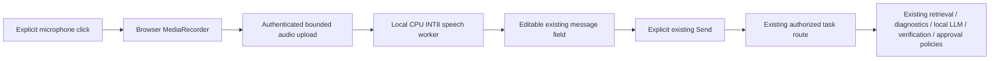

# Current features

## Versioned diagnostic forms (10 October 2026)

`/integrations` now derives seven task-specific forms from the authoritative
`tsdiag.input_contract` Pydantic models, exposed through the authenticated
`GET /api/integrations/diagnostic-contracts` endpoint. There are no prefilled toy
signals. Switching workflows clears measurements and metadata. Arrays support
JSON import; numeric arrays also support headerless CSV, one sample per row.
Matrices are `[observations, channels]`; vectors require one CSV column.
No implicit column mapping or unit conversion is performed.

Every request requires `contract_version=industrial-diagnostic-v1`, an exact
domain/task/policy combination and collection metadata: asset ID, physical
specimen ID, dataset ID/revision, UTC acquisition start/end, provenance
(`synthetic`, `real`, `public_dataset`) and operating context. An observation-log
document ID is optional, but existing document/sensor linkage checks still apply.

| Workflow | Required measurement/configuration fields |
|---|---|
| Bearing / fault diagnosis | `signal` (>=256 samples), `sampling_rate_hz`, `signal_unit` (`g` or `m/s^2`), `channel_name`, `sensor_location`, `bearing_id`, `shaft_speed_rpm`, `load_percent`, `fault_frequencies` with BPFO/BPFI/BSF/FTF in Hz |
| Process / root cause | `signal_matrix`, `normal_reference`, `channel_names`, `channel_units`, `sampling_rate_hz`, `reference_id`, `reference_revision` |
| Wind SCADA / monitoring | `train_matrix` (>=60 healthy rows), `prediction_matrix`, `channel_names`, `channel_units`, `train_timestamps`, `prediction_timestamps`, `reference_id`, `reference_revision` |
| Battery / cell anomaly localization | `cell_voltage`, `cell_temperature`, `cell_ids`, `timestamps`, `pack_current`, fixed units `V`, `degC`, `A` (positive current = charging) |
| Battery / capacity prognosis | `cycle_index`, `capacity_ah` (>=20 observations), `nominal_capacity_ah`, `eol_capacity_ah`, `capacity_unit=Ah`, `battery_id` |
| Turbofan / RUL | `signal_matrix`, `channel_names`, `channel_units`, `cycle_index`, per-cycle regime IDs `operating_conditions`, `engine_id`, `regime_map_revision`, `require_calibrated_rul=true`; registered `trained_rul_model` reference required |
| Transformer / fault diagnosis | `signal_matrix` (>=32 rows), `sampling_rate_hz`, ordered `sensor_positions`, `channel_units`, `fundamental_hz` |

Other matrices/vectors require at least eight rows. These are computational input
floors, not evidence of sufficient diagnostic accuracy. The generated catalogue
contains exact types, enum values, sizes and optional registered model slots.

The server rejects legacy/unversioned payloads, unknown fields, threshold
overrides, non-finite/coerced values, ragged arrays, misaligned channels/units,
invalid timestamp/cycle order, overlapping Wind reference/prediction periods,
invalid frequencies and inconsistent specimen IDs. Validation runs before
integrated analysis and again at the diagnostic HTTP/tool boundary. Uploaded
workbench JSON must meet the same contract. Authorization and ControlPlane's
2,000-ms gate are unchanged; validation does not prove data authenticity.

Public model selection additionally requires a loaded, checksummed artifact with
matching `metadata.input_profile` (contract version, task, ordered channels,
units, sampling rate). Public Transformer requests no longer silently select a
default classifier. Missing/incompatible models abstain. Bearing currently
exposes its physics workflow, not the separate experimental CNN benchmark.

Last consolidated: 1 October 2026

## Project purpose

SovereignAI is a local-first industrial AI workbench for confidential manufacturing and maintenance work. It is being built to help authorized engineers turn company documents, equipment history, and sensor data into evidence-backed recommendations without sending sensitive data to public AI services.

The project aims to prove that a small local AI system can:

- retrieve only evidence the operator is authorized to see;
- combine documentary and sensor evidence without letting the language model perform safety-critical calculations;
- show citations, uncertainty, conflicts, approvals, and a complete audit trail;
- fail safely when evidence, models, or required services are unavailable; and
- remain advisory—qualified people retain authority over maintenance and physical equipment.

The target outcome is a reproducible Pump-102 industrial pilot in which every released recommendation can be traced from authorized inputs through diagnosis, verification, approval, artifact generation, and a tamper-verifiable Evidence Capsule.

## System boundary

The stable system boundary is:

```text
authenticated operator
  -> authorization and ControlPlane precheck
  -> authorized GraphRAG + sensor diagnostics
  -> bounded evidence context + local Ollama/vLLM generation
  -> ControlPlane release decision
  -> recommendation, scoped artifact, audit, Evidence Capsule
```

SovereignAI owns identity, authorization, orchestration, audit, approvals, and artifacts. Graph-RAG retrieves documentary evidence, the Time-Series Diagnostic Agent produces sensor evidence, and ControlPlane is the final release gate. Required-service failures fail closed.

## Implemented capabilities

| Area | Current capability |
|---|---|
| Local inference | Provider-neutral Ollama/vLLM text generation, Ollama vision, role-aware readiness, streaming, cancellation, timeouts, and FAST/STANDARD/DEEP execution |
| Agent execution | Bounded plan/act/observe/verify flow using registered, schema-validated tools only |
| Evidence | Dense + BM25 retrieval, RRF, optional local reranker, revision/conflict handling, query-aware context compression, provenance, and citations |
| Industrial analysis | OCR and file-type dispatch, deterministic unit/threshold calculations, asset context, read-only telemetry, trends, and Pump-102 inspection workflow |
| Diagnostics | Typed integration with the Time-Series Diagnostic Agent and automatic routing when a valid diagnostic envelope is supplied |
| Governance | PII and prompt-injection checks, structured claim support states, ControlPlane precheck/release control, abstention, and fail-closed handling |
| Security | Local sessions, CSRF, RBAC plus contextual ACLs, authorization before retrieval scoring, scoped caches/resources, and requester/approver separation |
| Execution safety | Generated Python runs only in a restricted, networkless Docker sandbox; there is no host fallback |
| Workflows | Versioned declarative Workcell Packs resolved only to trusted handlers; Pump Inspection v1.0.0 is included |
| Organizations | Validated Organization Packs for hierarchy, users, policies, assets, documents, and organization-scoped Workcells |
| Outputs | Real DOCX, XLSX, and PPTX artifacts with task/evidence lineage |
| Audit and provenance | Persisted task/tool/decision events, SSE progress, SHA-256 Evidence Capsules, independent verification, and optional Ed25519 signing |
| UI | Next.js workbench plus metrics, sovereignty, organization, assets, and onboarding surfaces |

## Flagship workflow

The Pump-102 path combines authorized manuals/SOP/history, sensor diagnosis, deterministic engineering checks, local synthesis, factuality/release control, human approval where required, a maintenance artifact, and an Evidence Capsule. Recommendations remain advisory and cannot command PLC, DCS, SCADA, alarms, setpoints, or equipment.

## Runtime and data

- FastAPI backend and Next.js frontend.
- SQLite for prototype state, audit, metadata, chunks, and caches.
- Local MiniLM embeddings with explicit feature-hashing fallback.
- Configured model roles: GENERAL, VISION, and CODER.
- Loopback/private internal service URLs only; public model/service URLs are rejected.
- APEL synthetic demo: 20 assets, 55 files, seven users, five scenarios, and a 50-question evaluation set.

## Inference experiment tooling

The local-only `local_testing/benchmarks/inference_tradeoff.py --protocol controlled` now runs the version-3
host-local protocol implemented in `local_testing/benchmarks/inference_controls.py`. These harnesses are ignored by Git and must be backed up separately. The old
warm-only protocol is explicitly `legacy-controlled`; `smoke` remains compatible.
Neither legacy mode can mark an experiment complete.

- Provider API identity plus local listener/process identity: Ollama version,
  digest, format, quantization, template/system hashes and selected runtime
  settings; vLLM/PyTorch/Transformers/Python versions, pinned local HF revision,
  weight/config hashes, explicit dtype and selected runtime settings. vLLM must
  use the same Python environment as its harness. Drift fails the experiment.
- Host OS/CPU/RAM and normalized-source harness hash. Per-batch 50 ms host
  available RAM and provider process-tree RSS samples, including errors and
  limitations; unavailable measurements never become zero-valued substitutes.
- Provider-verified **full prompt-token ceilings**, including template overhead.
  The complete fixture is retained; budgets too small for it fail. Neutral padding
  fills remaining space. vLLM uses `/tokenize`; Ollama uses untimed one-token
  calibration. Measured provider usage must agree exactly with calibration.
  `target_tokens` is retained only as a v3 compatibility alias for
  `prompt_token_budget`; historical v2 values remain whitespace words.
- Seeded shuffled repetition blocks cover requested budgets, concurrency 1/2/4,
  warm fresh/reused prefixes, and unprimed cold batches. Each lane has its own
  nonce. Warm-ups are excluded from summaries. Batch throughput uses the actual
  batch wall-clock interval, not a sum across repetitions.
- Reset after calibration and before every batch: Ollama unload acknowledgement
  plus `/api/ps` absence; vLLM requires an external restart, disappearance of the
  previous process tree, a newly created listener, and matching runtime identity.
  The harness never invokes shell commands, terminates processes, or evicts OS
  caches. Failed reset means no cold request. Cold concurrency describes an
  initially cold **batch**, not an independently cold model for each lane.
- Versioned expected-fact/citation JSON schema and fixture provenance/review
  metadata. The shipped fixture is explicitly synthetic and unreviewed. Final
  execution refuses it; `--plan-only` makes no runtime requests. Lexical output
  scoring remains a proxy, even with reviewed expected labels.
- `summary.json` records separate completion gates for both providers, identity
  and its consistency, cold state, warm-ups, memory, complete condition coverage,
  valid token accounting, reviewed real quality labels and failures. Host-local
  partials remain incomplete until a strict matching-config merge. Raw JSON/CSV,
  prompts, answers, samples and source-report hashes are retained. Existing output
  directories cannot be overwritten by a new run.

No final large live benchmark has been run with this protocol. Windows Ollama
and WSL BF16 vLLM constitute a **runtime + format + host** comparison. Process RSS
is not VRAM, may double-count shared pages, and misses between-sample peaks; WSL
reports guest memory. A process restart is not disk/page-cache cold. vLLM loads
weights before serving, so its measured cold request excludes server startup;
Ollama's post-unload request may include loading. Prefix reuse is a controlled
input condition, not proof of a cache hit. The two budget experiment labels both
use full prompt ceilings with fixed evidence; they do not measure retrieval or
evidence-selection quality. See `NEXT_PLAN.md` for commands and remaining gates.

## Important limits

- The project is a prototype, not a production security or safety accreditation.
- GraphRAG needs approved local/self-hosted storage for a strict offline deployment.
- SQLite, in-memory live channels, and local identity are single-node foundations.
- The optional reranker must be staged locally; otherwise retrieval uses RRF fallback.
- OCR, vision, diagnostics, and recommendations require qualified human review.
- Evidence Capsule integrity proves stored-byte integrity, not factual correctness.
- Live enterprise identity, historian, OPC-UA, SAP/Maximo, durable queues, PKI/HSM, malware scanning, encryption/key management, backup/recovery, and signed append-only audit are not yet implemented.
- Plant writes and autonomous maintenance execution are intentionally absent.

See [Past experiments](PAST_EXPERIMENTS.md) for evidence and [Next plan](NEXT_PLAN.md) for priorities.

## ControlPlane verification profiling — 17–18 October 2026

ControlPlane reports sanitized per-run stage timings, NLI pair/forward counts,
batch shapes, model/runtime/device identity, process memory and final action.
Phase 5 no longer repeats unused full-context numeric/date extraction for every
claim. Request-scoped structured evidence tokens and identical claim selections
are reused without crossing source or request boundaries. A distinct relevant
structured passage omitted by the top-k NLI limit prevents an otherwise
supported claim from being released until it is examined. The existing policy
deadline, evidence authority checks and human-review actions remain in force.
Unexamined claims beyond the NLI claim limit, fabricated structured citations,
and support naming only a different asset also abstain. Narrow numeric helpers
cannot clear a semantic coverage hold. No alternative NLI backend or selective
scheduler is enabled; CPU thread/batch defaults are unchanged.

## CPU-only microphone input — 19 October 2026

The workbench microphone is an additional input to the existing task composer.
Click the microphone, grant permission, speak, and click **Stop**. The UI shows
recording time, local processing, errors, and a transcription-ready message.
**Cancel voice** discards the recording or ignores a pending result. The recognized
text is appended to any existing draft. Review asset identifiers and other wording,
edit the message, then click **Run task** (or Enter). Nothing is submitted automatically.
The microphone is never activated on page load. New task and Send are blocked
while recording or processing; navigation/logout releases the microphone.



The transcription endpoint cannot create tasks, retrieve documents, execute tools,
approve actions, or call the LLM. Submitted text uses the existing
`/api/tasks/start` workflow and its current routing and policy decisions; voice
does not change when that workflow chooses GraphRAG, diagnostics, or ControlPlane.
An unsupported or ambiguous question therefore has exactly the same limitations
as its typed equivalent. Diagnostic requests still need validated measurements.

### Runtime choice and installation

The default model is **faster-whisper tiny.en**, loaded with `device="cpu"` and
`compute_type="int8"`. It fits the existing Python/FastAPI backend and avoids a
separate executable build. Its PyAV dependency bundles FFmpeg decoding libraries:
no system FFmpeg, CUDA, GPU, cloud speech API, or additional PyTorch install is
needed for speech. [faster-whisper upstream](https://github.com/SYSTRAN/faster-whisper)
documents CPU INT8 and local model directories. The evaluated alternative,
[whisper.cpp](https://github.com/ggml-org/whisper.cpp), supports quantized CPU models
and Windows, but adds native binary/build and model-format maintenance here.

From the `1_SIH` root, with the existing backend dependencies already installed:

```powershell
.\.venv\Scripts\python.exe -m pip install -r backend\requirements-voice.txt
.\.venv\Scripts\python.exe scripts\download_voice_model.py
Set-Location frontend
npm ci
Set-Location ..
```

The download command is the only online provisioning step. It downloads the
CTranslate2-format `Systran/faster-whisper-tiny.en` model to
`models/faster-whisper-tiny.en`. Copy this complete directory and the installed
packages to an offline machine if needed. Upstream weights are third-party assets;
retain their license when distributing them. Model binaries are Git-ignored.
The application forces offline loading and never downloads a missing model.
Missing packages, missing files, or incompatible model files return
`ASR_MODEL_UNAVAILABLE`. The first valid recording starts a separate worker and
loads the model once; later requests reuse it. Restarting or timing out a worker
causes the next request to initialize again.

Start the backend from the project root so `.env` relative paths resolve there:

```powershell
$env:SOVEREIGN_AUTH_MODE = "local"
.\.venv\Scripts\python.exe -m uvicorn app.main:app --app-dir backend --host 127.0.0.1 --port 8000
```

In a second terminal, from `1_SIH`:

```powershell
Set-Location frontend
$env:NEXT_PUBLIC_API_URL = "http://localhost:8000"
npm run dev
```

Open **http://localhost:3000** and sign in with an existing task-enabled account.
Use `localhost` consistently for UI and API so the existing Strict session and
CSRF cookies share a host. For a new synthetic APEL installation, use the seed
instructions in the repository README first. Keep the existing industrial
services and local LLM running for the same governed answers available to typed
questions. Remote browsers require HTTPS and the existing approved deployment
origin configuration; microphone APIs require a secure context or localhost.

Try “What is the current condition of Pump-102?”, stop, correct the asset spelling
if necessary, and send. Try “Retrieve the maintenance history of Pump-102.” and
“Explain the anomaly detected in Pump-102.” in the same way. Voice does not invent
missing evidence or measurements, or override a held/blocked response.

### Configuration and security boundaries

All settings use the `SOVEREIGN_` prefix and are listed in `.env.example`.

| Setting suffix | Default | Purpose |
| --- | --- | --- |
| `VOICE_MODEL_PATH` | Absolute project `models/faster-whisper-tiny.en` directory | Local CTranslate2 model files |
| `VOICE_LANGUAGE` | `en` | Explicit recognition language; English is the validated initial mode |
| `VOICE_CPU_THREADS` | `2` | CPU inference threads per backend worker |
| `VOICE_MAX_DURATION_SECONDS` | `30` | Hard decoded PCM duration limit; browser auto-stops slightly earlier |
| `VOICE_MAX_UPLOAD_BYTES` | `8388608` | 8 MiB encoded audio limit, including chunked uploads |
| `VOICE_UPLOAD_TIMEOUT_SECONDS` | `15` | Maximum upload wait |
| `VOICE_TIMEOUT_SECONDS` | `90` | Worker response deadline, including decoding and initialization |

For base English, provision `--model base.en` and set `VOICE_MODEL_PATH` to that
complete directory (prefer an absolute path). The language/model seams can support
multilingual models later. VAD, hands-free capture, streaming and spoken responses
are intentionally absent; the recorder and speech service are separate extension
points for those features. No agent logic is duplicated.

`GET /api/voice/config` and `POST /api/voice/transcribe` require the existing
`task.create` permission. POST uses the existing session cookie, credentials and
CSRF mechanism. Sessions and permissions are revalidated after upload and before
returning a transcript. Development auth-disabled behavior remains the same as
typed input; production still forbids disabled auth. Configuration and successful
transcript responses use `Cache-Control: no-store`.

POST accepts a **raw audio body**, not a multipart file. WebM/Opus, Ogg/Opus, MP4
audio, and WAV are allowlisted; declared MIME type and container signatures must
agree. A fixed container decoder reads in-memory bytes and resamples to 16 kHz
mono. Decoded sample counting enforces duration even without metadata. Invalid,
silent, empty, overlong, oversized, and non-audio inputs fail safely. There are no
audio filenames, shell commands, external URLs, multipart disk spools, or temporary
recordings to clean up. Request audio buffers are released; the worker retains
model weights, not a recording history. ASR logs/errors omit audio and transcripts.
After explicit Send, the existing text-task audit and retention rules apply.

One speech job runs per backend process, with no inference queue; overlapping jobs
receive `429 VOICE_BUSY`. Native inference runs outside the API event loop. A hard
response timeout terminates the worker, releases capacity, and returns 504. Cancel
stops the browser microphone/upload and suppresses late results; work already sent
to the server may finish until its deadline. Capacity remains occupied until that
work ends. Use one Uvicorn worker on the target laptop; multiple server workers
would each load a model. Configure normal reverse-proxy connection/body limits for
larger deployments; this prototype does not add a distributed per-user rate limiter.

### Verification and measured performance

Run from `1_SIH`:

```powershell
.\.venv\Scripts\python.exe -m pytest tests\voice -o addopts="" -q
.\.venv\Scripts\python.exe -m pytest local_testing\tests -o addopts="" -q
Set-Location frontend
npm run test:voice
npm run typecheck
npm run build
Set-Location ..
node --test local_testing\frontend_diagnostic_contract.test.cjs
```

The new tests are tracked under `tests/voice` and `frontend/voice-tests`; existing
local regression tests remain in their original ignored locations. Automated tests
use mocked recognition and synthetic PCM, with no model download or real microphone.
Decoder/missing-model subprocess tests skip when optional PyAV is not installed.
Backend tests use an isolated temporary database. Coverage includes authentication,
CSRF, permission denial, expiry/revocation during ASR, upload byte/duration/time
limits, bad formats, unavailable models, repeat requests, hard termination, model
reuse, explicit reviewed submission, existing release/human-review decisions, and
prompt-injection blocking. Recorder tests cover start/stop/cancel, late permission
and response races, disconnects, format support, empty/large recordings, timeout,
auto-stop, and no automatic task submission.

Verified on 19 October 2026: **25 new backend tests passed; 13 recorder tests
passed; 367 existing backend tests passed and 1 skipped; 9 existing frontend
contract tests passed**. Type checking, production build, and `pip check` passed.
Existing suites emitted deprecation/statistical warnings; no failures were observed.

A Windows offline synthetic voice fixture asked two Pump-102 questions in
**7.613 seconds**. Intel Family 6 Model 154, 12 logical CPUs, tiny.en CPU INT8,
2 inference threads, three consecutive local-service runs:

| Run | Model initialization | Transcription | Service voice-to-transcript |
| --- | ---: | ---: | ---: |
| Cold | 0.696 s | 0.718 s | 3.013 s |
| Warm 1 | 0 s | 1.143 s | 1.160 s |
| Warm 2 | 0 s | 1.494 s | 1.523 s |

Peak sampled speech-worker resident memory was **223.8 MiB** at 20 ms intervals;
this excludes the API, browser, LLM and other services and is a sampled peak, not
an allocator high-water mark. Service latency includes spawn/IPC but excludes
microphone capture, permission interaction, and HTTP transport. To reproduce with
a supplied short local recording (the command never prints the transcript):

```powershell
.\.venv\Scripts\python.exe scripts\benchmark_voice.py C:\recordings\question.wav --runs 3
```

A real Chromium MediaRecorder encoded a synthetic microphone stream as WebM/Opus;
the real backend recognized it, populated the editable composer and waited for
explicit Send. Its measured stop/upload-to-response request took **1.570 s**.
The recognized text used “pump 102”; asset spelling remains reviewable. The browser
then submitted through `/api/tasks/start`. Editing the transcript to include an
instruction-bypass attempt and sending it again produced the existing policy block.
Physical microphone hardware/permission
prompts and Safari/Firefox were not exercised. External GraphRAG, ControlPlane,
and diagnostics services were unavailable locally; full live multi-service release
was not verified. Their authorization/release integration was verified with mocks
and the existing security regressions. Tiny-model recognition quality, noisy rooms,
industrial abbreviations, and accent coverage need representative human audio
evaluation before broader deployment.

Implementation files: `backend/app/api/voice.py`, `backend/app/multimodal/speech.py`,
`backend/app/main.py`, `backend/app/core/config.py`, `backend/requirements-voice.txt`,
`frontend/app/voice/{VoiceInput.tsx,recorder.ts}`, the existing composer/CSS,
`frontend/voice-tests/recorder.test.cjs`, `frontend/package.json`,
`tests/voice/test_speech.py`, `scripts/{download_voice_model,benchmark_voice}.py`,
`.env.example`, `.gitignore`, and `pyproject.toml`.
