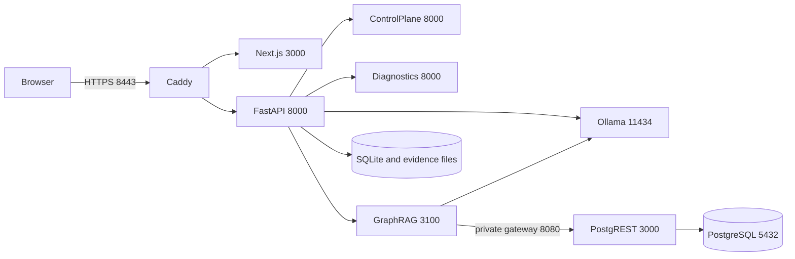

# SovereignAI Docker deployment

Target: the active `1_SIH` project, Linux x86-64 containers, one trusted server.
This is a production-oriented deployment candidate, not certification or plant
acceptance. Read [current validation](DOCKER_VALIDATION.md) before deploying.

## Architecture assessment

The inspected repository already has these application boundaries. Python APIs
share one image; ordinary Python modules remain inside their existing services.

| Container | Existing responsibility | Persistent state |
|---|---|---|
| frontend | Next.js standalone workbench; React, local CSS/assets | None |
| backend | FastAPI; identity, authorization, industrial orchestration, local retrieval, tools, artifacts, Evidence Capsules | SQLite, workspace, knowledge, organizations |
| controlplane | Independent privacy/policy/factuality verification API | JSONL decisions and feedback |
| diagnostics | Existing `tsdiag.api` time-series diagnostics API | Results returned to backend |
| graphrag | TypeScript evidence/retrieval API; local Ollama embeddings | PostgreSQL via PostgREST |
| graph-db / graph-rest | Existing evidence schema and Supabase-compatible REST interface | Graph database |
| ollama | CPU generation and embeddings | Model manifests/blobs and local identity |
| gateway | Caddy TLS ingress and private REST-prefix adapter | Local CA and gateway configuration |



Six internal networks separate ingress, API, governance, retrieval, inference
and graph storage. Only the TLS gateway also joins a normal `edge` bridge for
host port publication; that gateway can initiate outbound traffic if the host
allows it. Application/inference/database containers have no external route.
Ollama shares only inference with backend/GraphRAG; it shares
no network with protected APIs, frontend or graph storage. The backend remains
a trusted multi-network service. Container separation does not replace identity,
scope, policy, approval or action guards. ControlPlane verifies interactions;
the backend remains the established protected-tool authorizer. No Docker socket
or host credentials are mounted. No new protected-tool entry point is introduced.

Only `127.0.0.1:8443` is published. Browser requests use same-origin `/api/*`
through Caddy; internal callers use service names and container ports. Native
service interfaces/ports are unchanged. The old `docker-compose.yml` remains an
explicit legacy partial stack; use `-f compose.yaml` for this complete profile.
The root entry point includes the existing production profile and preserves its
`sovereign-production` project name and volume names.

The existing production tool configuration remains unchanged: shell/Python
execution, plant actions, vision and OCR tools are disabled in this profile.
Optional voice packages/weights are not installed. Optional coder/vision model
roles remain registered but require explicit provisioning. Qdrant is not part
of the active retrieval path. Cloud Supabase, external AI APIs, Redis, vLLM,
Kubernetes and the GraphRAG research browser client are not required.

## Requirements and Windows 11 / WSL2

- Docker Desktop Linux containers with WSL2 integration, or Linux Docker Engine.
  Confirm `docker info` reports a Linux server. Compose must be 2.24.4+ for the
  development override tags; confirm with `docker compose version`.
- A 16 GB RAM CPU laptop can attempt the profile with about 10–12 GB allocated
  to WSL2, four CPUs and swap. Close other heavy applications. Limits total about
  11.1 GiB; actual usage varies, and development Next.js needs extra headroom.
  These are initial budgets, not measured hardware-sizing guarantees.
- Prefer **25–35 GB free** for image layers, build cache, model storage and
  backup headroom. Check Docker's backing disk as well as the checkout disk.
- Host Python 3.11+ for provisioning/preflight/smoke/backup. Container Python is
  3.11. Native application development should use 3.11 with the existing Torch
  pin. Host Node is not required to run built containers.

Install WSL2 and Docker Desktop with the vendor installers, enable Linux
containers and integration for your WSL distribution. In VS Code use **WSL:
Open Folder in WSL**. Prefer a checkout in WSL's home filesystem over `/mnt/c`
for bind-mount performance. No privileged containers are needed.

All commands run from `1_SIH`. Multiline examples use WSL Bash. Single-line
Docker/Python commands also work in PowerShell. Replace `cp -n` with `Copy-Item`
only after checking that the destination does not already exist.

## Install and provision on a connected staging machine

Create/reuse an isolated host Python environment for the small helper packages:

```bash
python3.11 -m venv .venv
. .venv/bin/activate
python -m pip install PyYAML==6.0.3 huggingface-hub==0.36.2
cp -n deploy/.env.example deploy/.env
python scripts/prepare_production.py
```

Preparation preserves complete credentials and refuses partial sets. Restrict
`deploy/secrets/` to the operator with directory permissions/Windows ACLs.
The root `.env.example` describes native development, not container injection.
Review `deploy/.env`, then validate and build:

```bash
python scripts/preflight_production.py --static
docker compose --env-file deploy/.env -f compose.yaml config --quiet
docker compose --env-file deploy/.env -f compose.yaml build backend frontend graphrag gateway
docker compose --env-file deploy/.env -f compose.yaml pull --ignore-buildable
python scripts/stage_production_models.py --download
```

The three HF models are NLI DeBERTa, MiniLM embeddings and MiniLM reranking.
`deploy/model-lock.json` pins commits, file sizes and SHA-256 values. Staging
verifies existing directories without overwriting them; omit `--download` to
use existing cache only. Runtime Hugging Face/Transformers downloads are disabled
and missing artifacts fail closed. Weights stay in read-only `deploy/models/`,
outside ordinary application images.

Next.js and GraphRAG use `npm ci` and existing locks; application bases are
digest-pinned. Python direct dependencies have constraints and existing CPU
Torch/Transformers pins. Transitive Python packages and Debian repositories are
not fully hash/snapshot locked. Rebuilds are controlled candidates, not promised
byte-identical artifacts; promote tested image IDs/digests and transfer exact
built images to offline targets.

Provision default Ollama generation/embedding models from a verified local cache:

```bash
docker pull python:3.11-slim-bookworm
python scripts/provision_ollama_models.py --volume sovereign-production_ollama-models
```

Use `--cache /path/to/.ollama/models` when needed. The existing provisioner verifies
`deploy/ollama-model-lock.json`, copies only required manifests/blobs, refuses
conflicting tags and checks storage across recreation. It never copies host
Ollama private keys. Its Python helper image must be preloaded for offline use.
If necessary, provision the host cache first on the connected machine:

```bash
ollama pull qwen3:4b-instruct
ollama pull nomic-embed-text
```

A moved upstream tag may not match the reviewed lock; do not bypass a mismatch.
Acquire approved artifacts or review a new model lock and evaluation. Custom
generation/embedding models need revised provisioning/validation, and embeddings
must remain compatible with the existing 384-dimensional retrieval representation.
Optional coder/vision models are never downloaded at startup.

## Start, provision identity and access the UI

```bash
python scripts/preflight_production.py
docker compose --env-file deploy/.env -f compose.yaml up -d --no-build --pull never
docker compose --env-file deploy/.env -f compose.yaml ps
docker compose --env-file deploy/.env -f compose.yaml exec backend python -m app.identity.provision --email operator@example.internal --organization company --workspace engineering --department operations --role ENGINEER
```

Enter a unique password interactively and use actual scoped identifiers. There
are no default/demo accounts. Create separate accounts/roles for approvals.
`/health` is liveness; `/ready` intentionally returns 503 until an enabled user
exists and dependencies/configuration/storage/model checks pass. The frontend
and gateway start independently, avoiding an empty-identity startup deadlock.
Import your actual organization pack and approved SOP corpus through the existing
onboarding process. A healthy empty graph supplies no evidence. Backend knowledge
and GraphRAG ingestion remain separate; no automatic synchronization is added.

Export the gateway public CA, trust it on authorized clients, and open
**https://localhost:8443**:

```bash
docker compose --env-file deploy/.env -f compose.yaml cp gateway:/data/caddy/pki/authorities/local/root.crt deploy/local-root.crt
python scripts/preflight_production.py --url https://localhost:8443 --ca deploy/local-root.crt
python scripts/docker_smoke.py
```

Use your OS/browser certificate manager to trust the public CA. Never publish its
private key or disable TLS verification to pass testing. For LAN access configure
internal DNS, `SOVEREIGN_HOST`, a specific `BIND_IP` and approved certificate trust.
`HTTPS_PORT` configures the host binding and browser origin; the container listens
on 8443. Databases, Ollama and governance APIs have no published host ports.

## Stop, restart, logs and development

```bash
docker compose --env-file deploy/.env -f compose.yaml logs --tail 100 -f backend controlplane graphrag
docker compose --env-file deploy/.env -f compose.yaml restart backend
docker compose --env-file deploy/.env -f compose.yaml stop
docker compose --env-file deploy/.env -f compose.yaml start
docker compose --env-file deploy/.env -f compose.yaml down
```

`down` retains volumes; do not add `-v` during normal shutdown. Existing lease,
checkpoint and receipt logic marks abandoned tasks interrupted; restart does not
automatically replay consequential operations. Review unknown outcomes before
resuming. Use one backend process/replica with SQLite and current lease semantics.

Opt into hot reload using the same identity, governance, TLS and data volumes:

```bash
docker compose --env-file deploy/.env -f compose.yaml -f compose.dev.yaml up -d --build
```

Backend `app` and frontend `app`, `lib`, `public` are read-only bind mounts.
The development frontend container layer is writable for generated `next-env.d.ts`.
Dependency/config changes and shared diagnostic/ControlPlane package edits require
image rebuilds. Use VS Code terminals, container logs, `exec backend sh`, and local
tests. Match Next's development origin allowlist to your chosen hostname.

Reuse a host Ollama instance with this explicit development override:

```bash
docker compose --env-file deploy/.env -f compose.yaml -f compose.dev.yaml -f compose.host-ollama.yaml up -d --build
```

It replaces the daemon with a small Caddy proxy named `ollama`, forwarding to
`host.docker.internal:11434`; existing host model storage stays untouched. Backend
local-destination checks remain intact. Make host Ollama reachable from Docker's
host gateway. Loopback-only listening may be insufficient on your platform; if
rebinding, restrict the listener with host firewall rules to the Docker/WSL subnet.
Verify `host-gateway` mapping on Linux. This override deliberately permits host
network egress and is not the isolated offline profile. Stop development mode
before switching back to production images in the same project.

## Storage, backup and restoration

Nine persistent volumes retain the previous production names: `backend-data`,
`workspace`, `knowledge`, `organizations`, `controlplane-audit`, `graph-data`,
`ollama-models`, `gateway-data`, `gateway-config`. SQLite stores accounts, sessions,
approvals, checkpoints, receipts and backend audit. Workspace stores uploads,
artifacts and Evidence Capsules. Native databases/model stores are not migrated
or overwritten automatically. Never share application volumes with Ollama.

Cold backup keeps SQLite, PostgreSQL and evidence files consistent:

```bash
docker compose --env-file deploy/.env -f compose.yaml stop
python scripts/docker_backup.py backup /secure-backups/sovereign-2026-11-05
docker compose --env-file deploy/.env -f compose.yaml start
```

The helper requires stopped services, checks source volumes, streams binary tar
without PowerShell redirection corruption, and records archive hashes. It does
not prune/delete volumes. Encrypt/protect backups: they contain private evidence,
identities, sessions, models and CA keys. Separately preserve the exact release,
image IDs, `deploy/.env`, complete `deploy/secrets/`, `deploy/models/` and locks.
Hashes detect corruption, not malicious replacement; authenticate the inventory.

Restore matching release files, secrets/models and loaded images into a NEW
project while the original stays stopped:

```bash
python scripts/docker_backup.py restore /secure-backups/sovereign-2026-11-05 --project-name sovereign-recovery
docker compose --env-file deploy/.env -f compose.yaml -p sovereign-recovery up -d --no-build --pull never
python scripts/docker_smoke.py --project-name sovereign-recovery
```

Restore verifies all hashes before creating volumes and refuses existing targets.
After partial failure inspect the new project and resolve the cause; use a new
project name for retry. Keep originals until login, evidence/capsules, graph,
audit and inference pass a recovery drill. Use `-p sovereign-recovery` for every
later Docker operation and the smoke helper's `--project-name` option.

## Fully offline procedure

Stage and test on the target CPU architecture. A successful build alone does not
establish offline operation. Use the isolated production profile.

On the connected staging machine, complete provisioning and tests, then export
all runtime images and a cold volume backup (WSL Bash):

```bash
docker compose --env-file deploy/.env -f compose.yaml pull --ignore-buildable
mkdir -p ../sovereign-offline
mapfile -t images < <(docker compose --env-file deploy/.env -f compose.yaml config --images | sort -u)
docker image save -o ../sovereign-offline/images.tar "${images[@]}"
docker image inspect "${images[@]}" > ../sovereign-offline/image-inventory.json
docker compose --env-file deploy/.env -f compose.yaml stop
python scripts/docker_backup.py backup ../sovereign-offline/volumes
python -m pip download -d ../sovereign-offline/wheelhouse PyYAML==6.0.3 huggingface-hub==0.36.2
(cd ../sovereign-offline && sha256sum images.tar > images.tar.sha256)
```

Build the helper wheelhouse on the target OS/Python version. Transfer Docker,
Compose, Python installers and required OS prerequisites too. Copy the exact
release checkout (excluding `.git`, `.venv`, `node_modules`, local testing and
native user data), verified `deploy/models/`, locks, configuration/migrations,
`deploy/.env` and complete secret set with approved encrypted media. Cold backup
contains persistent Ollama weights, outside application images. Fresh installs
can transfer a locked host model cache and run the provisioner with its helper
image preloaded instead. Use fresh customer-specific credentials; never reuse
one installation's credentials across independent customers.

The supported offline path loads built images; it does not rebuild. Offline
rebuilds additionally require all base images, Debian packages/snapshots and
Linux Python/npm build caches. Authenticate transfer inventories separately.

On the disconnected target:

```bash
sha256sum -c images.tar.sha256
docker image load -i images.tar
python -m pip install --no-index --find-links wheelhouse PyYAML==6.0.3 huggingface-hub==0.36.2
```

Place release/config/secrets/models at their documented paths, restore volumes
into a new project as above (or provision fresh model/identity storage), and start
with `--no-build --pull never`. Verify local DNS/CA trust. With the target physically
disconnected, execute (add `--project-name` / `-p` for a recovery project):

```bash
python scripts/docker_smoke.py --inference
docker compose --env-file deploy/.env -f compose.yaml exec backend python /app/backend/scripts/verify_airgap.py --require-ollama
python scripts/docker_smoke.py --inference --restart-check
```

The default smoke test appends a labelled synthetic ControlPlane denial audit;
it runs no protected tool. `--inference` generates a short answer and embedding.
`--restart-check` recreates backend/ControlPlane, tests temporary marker persistence
in evidence/data volumes and retained denial audit, then removes its markers.
Schedule that option without active work. Existing checkpoint/resume regressions
cover uncertain-operation replay guards; smoke markers alone do not prove them.
Test authenticated workflows, real capsule verification and corpus retrieval too.
Inspect browser requests for local-only assets. The inspected frontend has local
CSS/assets and no external font/CDN imports. The existing air-gap probe covers
one namespace/destination, so also monitor all service/host egress.

## Required environment/configuration

`deploy/.env.example` contains all operator-facing Compose variables:

| Variable | Default / purpose |
|---|---|
| SOVEREIGN_HOST | `localhost`; TLS hostname and browser origin |
| HTTPS_PORT | `8443`; host TLS port |
| BIND_IP | `127.0.0.1`; published interface |
| SOVEREIGN_IMAGE_TAG | `production-candidate`; choose reviewed release tags |
| OLLAMA_GENERATION_MODEL | `qwen3:4b-instruct`; GENERAL and GraphRAG generation |
| OLLAMA_EMBEDDING_MODEL | `nomic-embed-text`; GraphRAG embeddings |
| OLLAMA_CODER_MODEL | `qwen2.5-coder:7b`; optional role |
| OLLAMA_VISION_MODEL | `qwen3-vl:4b-instruct`; optional role |
| OLLAMA_MEMORY_LIMIT / OLLAMA_CPUS | `5g` / `4.0`; inference budget |

Compose fixes production/local auth, secure cookies, explicit origins, disabled
demo seed, fail-closed integration, disabled deterministic/hash fallback, local
model paths, database/tool configs and internal URLs. Every injected value is in
`deploy/compose.production.yml`. `SOVEREIGN_OLLAMA_URL` and
`SOVEREIGN_OLLAMA_<registry-id>_MODEL` explicitly override only Ollama registry
entries; unset variables preserve defaults/other providers. Destination checks
still apply. OMP/MKL/OpenBLAS threads, loaded-model count and parallel inference
are bounded. HF/Transformers downloads and telemetry are disabled by image flags;
Python service caches use temporary storage, separate from read-only model
snapshots. Ollama cloud features and automatic model pruning are explicitly
disabled (`OLLAMA_NO_CLOUD=true`, `OLLAMA_NOPRUNE=true`).
ControlPlane loads local CPU NLI. `NEXT_PUBLIC_API_URL` is built empty for local
same-origin API requests, never credentials.

Six mounted credential files are generated, not hardcoded: `graphrag_token`
(backend/GraphRAG), `postgres_password` (database bootstrap), `graph_db_password`
(REST login initialization), `graph_rest_uri` (REST connection), `graph_jwt_secret`
(JWT verifier) and `graph_service_jwt` (GraphRAG). Plain Compose secrets are
protected bind files, not an encrypted vault. Renew the one-year service JWT
before expiry. Never regenerate bootstrap passwords against initialized storage.
GraphRAG's separate admin token is unset, keeping legacy global APIs disabled.

## Updates, rollback, limitations and troubleshooting

Back up first, assign a release-specific image tag, test in a separate project,
retain previous image IDs/config/secrets/models, then recreate during maintenance
with `up -d --no-build --pull never`. Startup SQL only initializes fresh volumes;
it is not an upgrade migration mechanism. Roll back compatible images/configs,
or restore the matching cold backup to a new project after schema changes.
Never point an old image at an unreviewed newer schema.

| Symptom | Check |
|---|---|
| Missing Docker pipe/socket | Start Desktop/engine, select Linux containers and the right context; run `docker info` |
| No disk space / extraction I/O failure | Stop builds, recover capacity through approved maintenance, check engine/storage health; do not bypass integrity checks |
| Secret/mount error | Preparation, complete credential set, WSL path and ACLs |
| ControlPlane unhealthy | Locked local NLI files/loading and logs; never disable policies |
| GraphRAG unhealthy | Database tables, JWT expiry, gateway REST route and both models |
| Backend 503 | Readiness booleans: identity, storage, dependencies and installed model |
| Login/CSRF failure | Trusted CA, configured HTTPS hostname/port and same-origin requests |
| Slow/OOM CPU | `docker stats`, OOM state, concurrent work and WSL budget; validate smaller approved models if needed |
| Empty model store | Correct project/volume/cache; startup never pulls missing weights |
| Hot reload missing | WSL checkout/polling; rebuild shared packages/dependencies |
| Restore refused | Use a new project and preserve existing volumes |

Application containers use non-root users, read-only production filesystems,
capability dropping, PID/memory/CPU limits, bounded Docker logs and health checks.
Ollama retains its official root-owned layout with capabilities dropped.
PostgreSQL starts with limited initialization capabilities then drops to
`postgres`. Internal ControlPlane/diagnostic APIs trust network membership;
compromised backend/host access remains a material risk. Persistent evidence is
not immutable or independently timestamped. Existing unsigned capsule/workcell
behavior is retained. No production-safety claim follows from Docker packaging.

Recommended next work: complete live acceptance/recovery drills, authenticated
plant workflows, transitive hash locks/SBOM/vulnerability review, service identity,
credential rotation, immutable audit retention, measured hardware sizing,
monitoring, explicit migrations and offline release gates.

References: Docker [include/path handling](https://docs.docker.com/reference/compose-file/include/),
[merge semantics](https://docs.docker.com/compose/how-tos/multiple-compose-files/merge/)
and [health-based startup](https://docs.docker.com/compose/how-tos/startup-order/).
